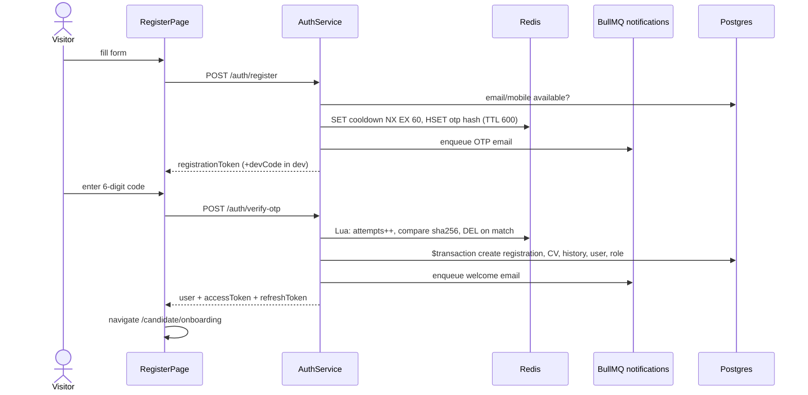
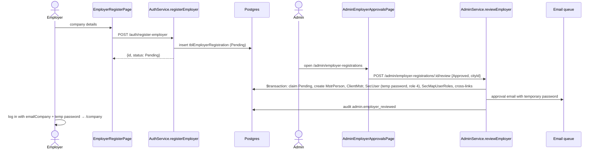
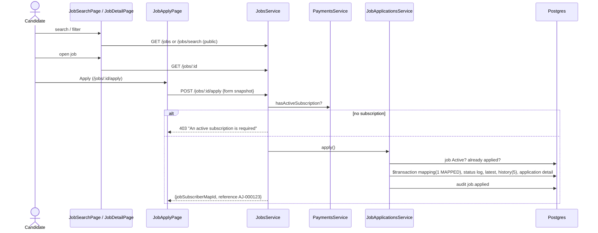
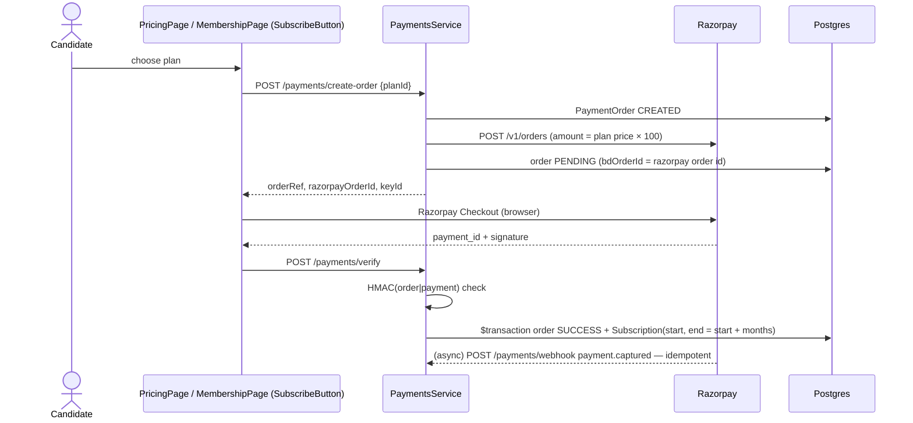
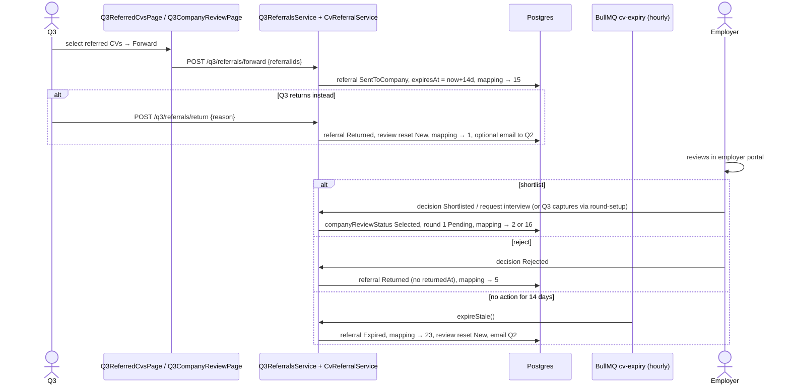
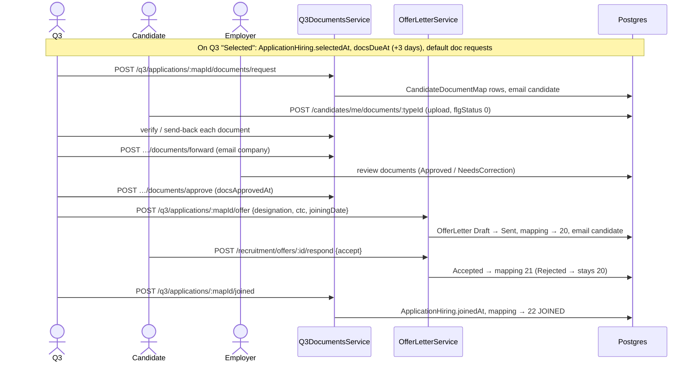
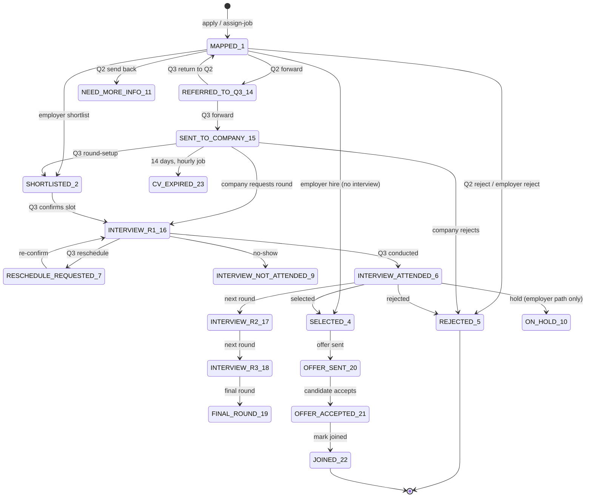

# Complete End-to-End Workflow

> Traced through the code at commit `8de48cf`. Each workflow answers: who initiates, which screen, which action, which frontend component, which API, which backend service, which tables, which checks, success path, failure path, who else is affected, and what notifications / status changes follow. "VERIFIED" facts come from reading code; anything inferred is marked.

## 0. The business in one picture

Aajiveka is a recruitment/ATS platform. Candidates pay for a subscription and apply to jobs posted by approved employers. Every application passes through three internal staff desks before and during the employer's own process:

- **Q1 (QC1)**: screens the candidate's profile.
- **Q2 (QC2)**: scores and matches the candidate against the job, then refers the best CVs to Q3.
- **Q3**: forwards CVs to the company, coordinates interview rounds, collects documents, and issues the offer through to joining.
- **Admin**: approves employers, manages users and moderates jobs.

```mermaid
flowchart LR
  subgraph Entry
    C[Candidate registers<br/>email OTP] --> CO[Onboarding wizard<br/>profile + CV]
    E[Employer registers] --> AA[Admin approves<br/>login created]
  end
  AA --> JP[Employer posts job<br/>Active]
  CO --> PAY[Buys subscription<br/>Razorpay]
  PAY --> AP[Applies to job<br/>status 1 MAPPED]
  JP --> AP
  AP --> Q1[Q1 screening<br/>Verified / FollowUp / ...]
  AP --> Q2[Q2 matching<br/>score 0-100]
  Q1 -. advisory only .-> Q2
  Q2 -->|forward| R14[14 REFERRED_TO_Q3]
  Q2 -->|send back| S11[11 NEED_MORE_INFO]
  Q2 -->|reject| X5[5 REJECTED]
  R14 -->|Q3 forward| S15[15 SENT_TO_COMPANY<br/>14-day window]
  R14 -->|Q3 return| Q2
  S15 -->|no response 14d| EXP[23 CV_EXPIRED<br/>back to Q2 queue]
  S15 -->|company shortlists| INT[Interview rounds<br/>2 / 16-19]
  S15 -->|company rejects| X5
  INT -->|Q3 or employer decision| SEL[4 SELECTED]
  INT --> X5
  SEL --> DOCS[Documents requested<br/>verified, forwarded, approved]
  DOCS --> OF[20 OFFER_SENT]
  OF -->|candidate accepts| OA[21 OFFER_ACCEPTED]
  OA --> J[22 JOINED]
```

---

## 1. Candidate registration (email OTP)

| # | Question | Answer |
|---|---|---|
| 1 | Initiator | Anonymous visitor |
| 2 | Screen | `/register` → `apps/web/src/features/auth/pages/RegisterPage.tsx` |
| 3 | Trigger | Register form submit, then OTP form submit |
| 4 | Frontend | `RegisterPage` (RHF + Zod), auth API hooks under `apps/web/src/features/auth/`, `auth.store` |
| 5 | API | `POST /api/auth/register` → `POST /api/auth/verify-otp` (`POST /api/auth/resend-otp` to resend) |
| 6 | Backend | `AuthController` → `AuthService.register` / `verifyEmailOtp` / `resendEmailOtp`; `OtpService` (Redis Lua script) |
| 7 | Data | Redis: `otp:register:email:<token>` (600 s), cooldown key (60 s). Postgres on verify (one `$transaction`): `tblSubscriberRegistration`, `tblSubscriberCVDetails` (emailVerified), `tblSubscriberStatusHistory` (1 Account created), `tblSecUser` (userName = mobile), `tblSecMapUserRoles` (role 1); then `tblSecActiveSessions`, `tblAuditLog` |
| 8 | Checks | DTO: name 2–100, valid email, mobile pattern (Indian `^[6-9]\d{9}$` for +91), password 8–72. Email must not belong to a verified candidate; mobile must not be an existing username. OTP: 6 digits, max 5 attempts, 10-min expiry, 60 s resend cooldown. 5 req/min/IP |
| 9 | Success | Tokens returned; `isOnboarded:false` → web routes the user to `/candidate/onboarding`. Welcome email queued |
| 10 | Failure | 409 email/mobile in use; 429 cooldown (with `retryAfterSeconds`); 400 wrong code (with `attemptsRemaining`) / expired / too many attempts; 503 if the email could not be queued. Nothing is written to Postgres before verification |
| 11 | Affected | Q1 queue gains a candidate (screening row is created lazily when Q1 views it) |
| 12 | Notifications | OTP email + welcome email (via BullMQ `notifications` queue). With the default `EMAIL_DRIVER=log` they are only logged. In non-production the API also returns `devCode` |

**Gaps**: no SMS/mobile verification (SMS providers exist but are never called); the welcome email links to `/profile`, which is not a web route.

## 2. Login, session and logout (all roles)

| # | Answer |
|---|---|
| 1–3 | Any user, `/login` (`apps/web/src/features/auth/pages/LoginPage.tsx`), Sign-in button |
| 4 | `LoginPage`, `useAuth` store (`apps/web/src/features/auth/auth.store`), `tokenStorage` (`apps/web/src/lib/tokenStorage.ts`) |
| 5 | `POST /api/auth/login`; later `POST /api/auth/refresh` (axios interceptor on 401), `GET /api/auth/me`, `POST /api/auth/logout` |
| 6 | `AuthService.login` / `refresh` / `me` / `logout` |
| 7 | Reads `tblSecUser` (by username, else email via `tblSubscriberCVDetails` or `tblMstrPerson`), `tblSecMapUserRoles` (role source of truth); writes `tblSecActiveSessions`, `tblSecUserLogin`, `tblAuditLog` |
| 8 | Argon2id verify (dummy hash when user missing); `active='1'`; 5 attempts/min per IP; no per-account lockout |
| 9 | Web stores tokens, redirects to `ROLE_HOME[roleId]`: candidate `/candidate/profile`, QC1 `/q1/dashboard`, QC2 `/q2/dashboard`, employer `/company`, admin `/admin`, Q3 `/q3/dashboard` |
| 10 | 401 "Invalid username or password"; on refresh failure the axios interceptor clears tokens and sends the user to `/login` |
| 11 | — |
| 12 | Audit `auth.login` / `auth.logout` |

Notes: staff can sign in by username but not by email (NodeType 100, see ROLE_PERMISSION_MATRIX). Refresh tokens rotate and are single-use; access tokens are not revoked on logout (valid until expiry).

## 3. Password recovery

`/forgot-password` → `POST /api/auth/forgot-password {userName}` → `AuthService.forgotPassword` creates `tblAuthPasswordReset` (sha256 token, 1 h) and emails `${APP_URL}/reset-password?token=…`. `/reset-password` → `POST /api/auth/reset-password` → password updated, token marked used, **all sessions deleted** (transaction). The response is always generic. Forgot-password matches **username/mobile only**, not email. Admin can also trigger a reset link (`POST /api/admin/users/:id/password-reset`).

## 4. Candidate onboarding and profile building

| # | Answer |
|---|---|
| 1–3 | Candidate; `/candidate/onboarding` (`ProfileWizardPage`) then `/candidate/profile` (`ProfileOverviewPage`), `/candidate/resume-builder`; section Save buttons |
| 4 | `apps/web/src/features/candidates/portal/*` (`CandidatePortalLayout`, wizard steps, section editors) |
| 5 | `GET /api/candidates/me`, `/me/cv-edit`, `/me/cv-masters`, `/me/institutes`; `PUT /me/personal`, `/me/professional`, `/me/education`, `/me/employment`, `/me/certificates`, `/me/headline`, `/me/summary`, `/me/key-skills`, `/me/career-profile`, `/me/it-skills`, `/me/projects`, `/me/languages`, …; `POST /api/files/resume`, `/api/files/avatar`; `POST /api/candidates/me/complete-onboarding` |
| 6 | `CandidatesService` (`apps/api/src/modules/candidates/candidates.service.ts`), `StorageService` |
| 7 | `tblSubscriberCVDetails`, `tblSubscriberProfileExtra`, `tblSubscriberEducation`, `tblSubscriberEmployer`, `tblSubscriberCertificate`, `tblSubscriberITSkill`, `tblSubscriberProject`, `tblSubscriberAccomplishment`, `tblSubscriberLanguage`, `tblSubscriberPrefferedLocations`, `tblSubscriberTags`, `tblSubscriberCVUploaded`; first personal save also writes `CV_CREATED` history and `flgCVUploaded` |
| 8 | DTO validators per section; education degree/course consistency and year ranges; upload ≤10 MB, pdf/doc/docx/jpeg/png with matching extension; all writes scoped to the caller's `subscriberID` |
| 9 | Data saved; completing the wizard sets `onboardedAt`, so `ProtectedRoute` stops redirecting |
| 10 | 400 validation (incl. "Save your personal details first"); 404 if the login is not linked to a candidate profile (all migrated legacy candidates); FK errors on bad master ids surface as 500 (inferred) |
| 11 | Q1 completeness and priority, Q2 scoring and employer applicant views read this data |
| 12 | Audit for resume/avatar/document uploads only |

**Gaps**: the advanced section editor (`/candidate/profile/advanced`) is commented out in the router, so IT skills, diversity, personal details and accomplishments have no UI and profile completion cannot reach 100% (router comment). API and web compute profile completion differently.

## 5. Employer registration and approval

| Item | Detail |
|---|---|
| Checks | Duplicate `emailCompany` unless the previous one was Rejected (case-sensitive compare). Approval: must be Pending (409), no existing login with that username (409), city must resolve (400) |
| Failure | Reject sends no email. Approval rolls back entirely on error |
| Affected | Employer can now post jobs; company appears in `/admin/companies` |
| Gaps | Temporary password is emailed in plain text and nothing forces it to be changed; employers have no change-password endpoint; free-text `companyLogo` from the registration is copied to the company and served publicly (see issues) |

## 6. Job posting lifecycle (Employer, Admin)

| # | Answer |
|---|---|
| 1–3 | Employer; employer portal "Post job" / "Manage jobs" screens (`apps/web/src/employer/pages/ManageJobs/*`); Save draft, Publish, Close, Archive, Activate, Duplicate, Delete, Bulk upload |
| 5 | `POST /api/clients/me/jobs?draft=`, `PATCH /api/clients/me/jobs/:id?draft=`, `POST …/status`, `/deactivate`, `/archive`, `/activate`, `/duplicate`, `DELETE …/:id`, `POST /api/clients/me/jobs/bulk-upload?commit=` |
| 6 | `EmployersService.createJob / updateJob / setJobStatus / duplicateJob / deleteJob / bulkUploadJobs` |
| 7 | `tblClientJobs`, `tblClientJobSkill`, `tblMstrSkills` (new skills auto-created), delete cascades education/gender maps and saved jobs |
| 8 | Ownership (`ownedJob`); required designation, employment type, work mode, city, CTC range ints; **no min ≤ max checks**; delete refused when applications exist |
| 9 | Job is Active (1) immediately — **there is no review/approval state** — or Draft (4) |
| 10 | 404 not owner; 400 delete-with-applicants; bad master ids → FK error |
| 11 | Active jobs appear in public search, Q2 job lists, recommendations |
| 12 | Audit on status change and delete only (not on create/update/duplicate/bulk) |

Status states: **1 Active ↔ 2 Closed ↔ 3 Archived, 4 Draft** — any-to-any for the employer. **Admin** can only `close` / `reopen` (Active ↔ Closed) via `POST /api/admin/jobs/:jobId/status` or `bulk-moderate`; nothing prevents the employer re-activating an admin-closed job. Closing a job does not touch its in-flight applications.

## 7. Job search and apply (Candidate)

- Failure: 403 no subscription; 404 job not active; 400 already applied (race-prone: no unique index on job+candidate).
- No email to the candidate or employer. The application immediately becomes visible to Q2 (all applications on active jobs) **and to the employer** (all statuses).
- Staff can create the same application with `POST /api/recruitment/candidates/:id/assign-job` (no subscription gate).

## 8. Subscription purchase (Candidate)

- Plans: `GET /api/payments/plans` (12 seeded; tier not tied to the candidate's experience).
- Effect: a `tblSubscription` row only; it unlocks self-apply. Role is unchanged; no receipt email.
- Failure: 400 Razorpay not configured (the Docker compose files do not pass `RAZORPAY_*`); 400 bad signature; Razorpay HTTP failure → 500 leaving a CREATED order; concurrent verify + webhook can make one request 500 (unique subscription per order).
- **BillDesk** path (`POST /api/payments/orders` + `/payment/return` polling `GET /payments/orders/:orderRef`) can create orders but **cannot settle them**: `PaymentsService.settle()` has no route.

## 9. Q1 screening (QC1)

| # | Answer |
|---|---|
| 1–3 | QC1; `/q1/dashboard`, `/q1/candidates`, `/q1/candidates/:id`, `/q1/follow-ups`, `/q1/no-response`, `/q1/verified`, `/q1/not-interested`, `/q1/analytics`; buttons Verify, Contact, Request update, Request CV, Follow-up, No response, Not interested, checklist ticks |
| 4 | `apps/web/src/features/q1/pages/*`, `features/q1/components/*` |
| 5 | `/api/q1/*` (see API_DOCUMENTATION §8) |
| 6 | `Q1Service`, `Q1AnalyticsService` |
| 7 | `tblSubscriberScreening` (status, priority, 7 checklist flags, follow-up fields), `tblScreeningContactLog`, reads profile tables |
| 8 | `@Roles(QC1, Admin)`; DTO enums; **no precondition for Verify** |
| 9 | Screening status changes; priority recomputed (completeness ≥ 80 → High) |
| 10 | 404 unknown candidate; 400 validation |
| 11 | Q2 (advisory only — Q2 does not filter on Q1 status); Q3 shows "contact verified" |
| 12 | Audit `q1.*`; "Contact"/"Request CV" only **log** the attempt — no message is sent |

Screening states: `New → Screening` (on first open) → `Verified | FollowUp | NoResponse | NotInterested`; `Incomplete` when completeness < 100 or when Q2 sends back. The separate registration decision (`POST /api/recruitment/candidates/:id/decision`, Approved/Rejected/OnHold/NeedMoreInfo/Duplicate/Withdrawn) updates `tblSubscriberRegistration.flgstatus` and candidate history but **no application status**.

## 10. Q2 matching (QC2)

| # | Answer |
|---|---|
| 1–3 | QC2; `/q2/jobs` → `/q2/jobs/:jobId` → `/q2/applications/:mapId`; `/q2/applicants`, `/q2/forwarded`, `/q2/sent-back`; buttons Forward to Q3, Send back to Q1, Reject, criterion toggles |
| 4 | `apps/web/src/features/q2/pages/*` (e.g. `Q2ApplicantDetailPage.tsx`) |
| 5 | `/api/q2/*`; forward internally calls `CvReferralService.referToQ3` |
| 6 | `Q2Service`, `ScoringService`, `CvReferralService`, `JobApplicationsService.transitionStatus` |
| 7 | `tblCandidateJobScore` (7 sub-scores + total), `tblApplicationMatchReview`, `tblCvReferral`, mapping + status log, `tblSubscriberScreening` (on send-back) |
| 8 | Review must be `New` (409 otherwise). No confirmation dialog on Forward/Send back/Reject in the UI |
| 9 | Forward → **14 REFERRED_TO_Q3**, referral `Referred`. Send back → **11 NEED_MORE_INFO**, screening `Incomplete`. Reject → **5 REJECTED** |
| 10 | 404 / 409 |
| 11 | Q3 receives forwarded CVs; Q1 sees sent-back candidates as Incomplete |
| 12 | Audit `q2.*`, `cv.referred_to_q3`; no email to candidate |

Scoring (`apps/api/src/modules/recruitment/scoring.service.ts`): skills Jaccard 30%, experience 25%, job role 20%, education 10%, location 5%, salary 5%, notice 5%. Relevant ≥ 60. Scores are computed lazily on Q2 GETs (≤25 per request), not at apply time.

**Gap**: a send-back is a dead end — nothing returns the application to Q2's queue after Q1 re-verifies.

## 11. Q3: forward to company, company review, expiry

- Q3 can email companies whose review window is about to close (`POST /api/q3/company-review/remind-expiring`).
- Two shortlist outcomes exist depending on path: Q3 round-setup → **2 SHORTLISTED**; employer interview request / recruitment company-review → **16 INTERVIEW_R1**.

## 12. Interview rounds (Q3 + Employer + Candidate)

| Step | Who | Screen | API | Effect |
|---|---|---|---|---|
| Create round with 3 slots | Employer | Applicant detail (employer portal) | `POST /api/clients/me/applicants/:id/interview-rounds` | Round Pending + 3 slots; mapping → 16 (or 19 for Final); history 7 |
| …or capture shortlist/panel | Q3 | `/q3/scheduling/:mapId` | `PUT /api/q3/applications/:mapId/round-setup` | Round 1 Pending, slots; mapping → 2 |
| Ask company for slots | Q3 | `/q3/scheduling` | `POST /api/q3/rounds/:roundId/request-slots` | Email HR/company |
| Contact candidate | Q3 | `/q3/scheduling` | `POST /api/q3/applications/:mapId/contact` | Activity log |
| Confirm slot + send invites | Q3 | `/q3/scheduling/:mapId` | `POST /api/q3/rounds/:roundId/confirm` (optional Jitsi link from `/q3/meeting-link`) | Round Scheduled; mapping → 16/17/18/19; emails (IST) |
| …or candidate picks slot | Candidate | `/candidate/interviews` | `POST /api/recruitment/interview-rounds/:roundId/select-slot` | Round Scheduled; emails (server time zone); no status precondition |
| Reminder / day-of checklist | Q3 | `/q3/interviews` | `/remind`, `/checklist` | Email, flags |
| Reschedule / no-show | Q3 | `/q3/interviews` | `POST /api/q3/rounds/:roundId/reschedule` | Before start → 7 RESCHEDULE_REQUESTED; after start without join → 9 NOT_ATTENDED |
| Mark conducted | Q3 | `/q3/interviews` | `POST /api/q3/rounds/:roundId/conducted` | → 6 ATTENDED; result due in 24 h |
| Chase company | Q3 | `/q3/decisions` | `POST /api/q3/applications/:mapId/nudge` | Email |
| Decision | Q3 | `/q3/decisions/:mapId` | `POST /api/q3/rounds/:roundId/decision` | NextRound/FinalRound → new round; Hold → `onHoldAt` only; Rejected → 5; Selected (final round only) → 4 + default document requests |
| …or result | Employer | Applicant detail | `POST /api/clients/me/applicants/:id/interview-rounds/:roundId/result` | Select→next round or Hire (→4); Reject (→5); Hold (→10); candidate email |
| Decision email | Q3 | `/q3/decisions` | `POST /api/q3/rounds/:roundId/decision-mail` | Email |

**Conflict (confirmed)**: the employer path (`InterviewRoundService.submitResult`) and the Q3 path (`Q3InterviewsService.decide`) record decisions differently (different fields, different Hold/Select/Final semantics). After an employer "Hire", Q3 still shows the round awaiting a decision and the documents/offer flow does not start. See TESTING_AND_ISSUES.

## 13. Documents, offer and joining

- Offer creation requires mapping status 4 and **all** of the candidate's uploaded documents verified (across all applications). The Q3 route additionally requires `docsApprovedAt`.
- Alternate (legacy/shared) path: `POST /api/recruitment/offers` + `/offers/:id/send` + `/offers/:id/mark-joined` (Q3, Client, Admin). `mark-joined` there does not set `joinedAt`, so Q3 keeps showing the application in the Offer stage.

## 14. Application status state machine (JobMapStatus)

Simplified for readability: rounds R2/R3/Final follow the same confirm → conducted → decision loop as R1. The legacy path (`POST /api/recruitment/interviews`) can set 3 INTERVIEW_SCHEDULED from any state. **Statuses never written by any code**: 8 RESCHEDULED, 12 DUPLICATE, 13 WITHDRAWN. **`transitionStatus` itself enforces no from-state**; guards live (inconsistently) in callers.

Every transition writes a `tblJobSubscriberStatus` log row and updates `tblSubscriberJobStatusLatest`; only some write candidate history (`tblSubscriberStatusHistory`) — none of the Q3-path transitions do.

## 15. Admin operations

| Operation | Screen | API | Result |
|---|---|---|---|
| Create staff user | `/admin/users` | `POST /api/admin/users` | Person + login (random password) + emailed set-password link (3-day token); with log email driver the link is returned in the response |
| Activate / deactivate / change role | `/admin/users/:userId` | `PATCH /api/admin/users/:userId`, `POST /api/admin/users/bulk-update` | Transaction updates `tblSecUser` + `tblSecMapUserRoles`, deletes refresh sessions; never self, never across candidate/employer/staff |
| Send password reset | user detail | `POST /api/admin/users/:userId/password-reset` | 1-hour link emailed |
| Approve/reject employer | `/admin/employer-approvals` | `POST /api/admin/employer-registrations/:id/review` | See §5 |
| Close / reopen jobs | `/admin/jobs`, `/admin/jobs/:jobId` | `POST /api/admin/jobs/:jobId/status`, `/bulk-moderate` | Active ↔ Closed, audited per job |
| Inspect applications | `/admin/applications/:mapId` | `GET /api/admin/applications/:mapId` | Read-only timeline + deep link to owning workspace |
| Settings | `/admin/settings` | `GET/PATCH /api/admin/settings` | Stored only — **no code reads them** |
| Blog | `/admin/blog` | `/api/admin/blog-posts` | CRUD |
| Reports / exports | `/admin/reports` | `/api/exports/*` | CSV/XLSX/PDF |
| Audit | `/admin/audit` | `GET /api/admin/audit-logs` | Filtered audit browser |

## 16. Notifications summary

| Channel | Implemented | Triggered by |
|---|---|---|
| Email (BullMQ → SMTP/SES/log) | Yes | OTP, welcome, password reset, staff set-password, employer approval, legacy interview scheduled, slot selected, round results, offer sent, all Q3 mails (slot requests, invites, reminders, nudges, decisions, document requests/send-backs/forwarding, review-window reminders, return-to-Q2 mails, auto-expiry mails) |
| Email — not sent | — | application submitted, Q2 reject, forward to company, company reject, offer accepted/rejected, joined, payment receipt, job alerts |
| SMS | Providers only | **Never called** |
| In-app / SSE | Endpoints only | **Nothing creates notifications** |
| WhatsApp | — | Logged as a channel only |
