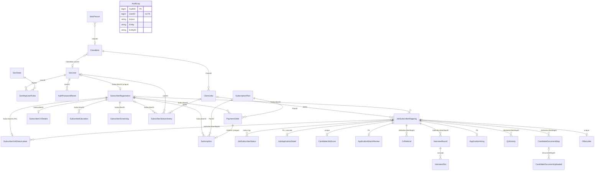

# Database Schema

> Derived from `apps/api/prisma/schema.prisma` at commit `8de48cf`. The database is **PostgreSQL 16**, accessed through **Prisma 7** with the `@prisma/adapter-pg` driver adapter. The schema came from a restore of the legacy SQL Server database (`db_aajiveka.bak`). That database had **73 tables and no declared foreign keys**, and 36 of its tables had no primary key. The relations in this schema were worked out from the JOINs in the legacy stored procedures (`db/procs/`) and then checked against the data with an orphan test. See [`db/ER-DIAGRAM.md`](../db/ER-DIAGRAM.md), [`db/SCHEMA_REPORT.md`](../db/SCHEMA_REPORT.md) and `db/foreign-keys.psv` (63 FK edges, each with a confidence rating).

Related docs: [PROJECT_OVERVIEW.md](PROJECT_OVERVIEW.md) covers infra, deploy and environment, [COMPLETE_WORKFLOW.md](COMPLETE_WORKFLOW.md) and [MASTER_SYSTEM_FLOW.md](MASTER_SYSTEM_FLOW.md) the pipeline, [ROLE_PERMISSION_MATRIX.md](ROLE_PERMISSION_MATRIX.md) the roles, [API_DOCUMENTATION.md](API_DOCUMENTATION.md) the endpoints, [MODULE_DEPENDENCIES.md](MODULE_DEPENDENCIES.md) the modules, and [TESTING_AND_ISSUES.md](TESTING_AND_ISSUES.md) the tests and known issues.

**Verified vs inferred.** Statements in this document were checked against the schema, the migrations or the source, unless they are marked *(inferred)*. `schema:N` means `apps/api/prisma/schema.prisma` line N. Other paths are relative to the repo root, and source paths are under `apps/api/src/` unless they say otherwise.

---

## Contents

1. [Conventions you must know first](#1-conventions-you-must-know-first)
2. [Data domains at a glance](#2-data-domains-at-a-glance)
3. [ER diagram (core entities)](#3-er-diagram-core-entities)
4. [Model reference by domain](#4-model-reference-by-domain)
5. [Status and enum value sets](#5-status-and-enum-value-sets)
6. [Tricky, polymorphic and misnamed columns](#6-tricky-polymorphic-and-misnamed-columns)
7. [Data lifecycle](#7-data-lifecycle)
8. [Migration timeline](#8-migration-timeline)
9. [Seeding and data migration](#9-seeding-and-data-migration)
10. [Data-layer issues](#10-data-layer-issues)

---

## 1. Conventions you must know first

| Convention | Detail |
|---|---|
| Table and column names | Every table keeps its legacy SQL Server name through `@@map("tblXxx")`, and every column keeps its PascalCase name through `@map("Xxx")`. In raw SQL you must quote identifiers: `"tblClientJobs"."JobID"`. |
| Prisma field names | Fields are camelCase, and some are mechanically odd: `pIN`, `dOB`, `cVPath`, `tImestampIns`, `uSERID`, `iD`. Look up the actual field name in the schema; don't guess it. |
| Connection config | Prisma 7 no longer keeps the URL in `schema.prisma`. It lives in `apps/api/prisma.config.ts`, which reads the `DATABASE_URL` env var (and the optional `SHADOW_DATABASE_URL`). The client is created in `apps/api/src/prisma/prisma.client.ts`. |
| Audit columns | Legacy tables carry `TimestampIns / LoginIDIns / TimestampUpd / LoginIDUpd`. New tables use `CreatedAt / UpdatedAt`, or `TimestampIns @default(now())`. |
| Status columns | Legacy status columns are **int ids** that point at master tables. New tables (Q1/Q2/Q3, offers, invoices, blog) use **free-text VARCHAR** statuses. No status column has a CHECK constraint, so the vocabularies are enforced only in TypeScript (`shared/status.ts`, `shared/screening.ts`, `shared/matching.ts`, `shared/hiring.ts`). |
| Enums | There is only one Prisma enum: `PaymentStatus` (schema:1310). |
| onDelete | Where `onDelete` isn't written, Prisma's default applies: **Restrict** for a required relation, **SetNull** for an optional one, with ON UPDATE CASCADE in both cases. The init migration emitted 27 `ON DELETE RESTRICT` and 39 `ON DELETE SET NULL`. Only two relations are explicitly `Cascade`: `JobApplicationDetail → JobSubscriberMapping` (schema:1538) and `InterviewSlot → InterviewRound` (schema:1639). |
| Id types | Most PKs are `BigInt` (bigserial). A few columns that hold the same concept are `Int`; see [§6](#6-tricky-polymorphic-and-misnamed-columns) and [I20](#10-data-layer-issues). |
| Omitted legacy tables | 13 dead tables (no rows, and no procedure references them) are left out. They are listed in `db/dead-tables.txt`. |

---

## 2. Data domains at a glance

The schema has 94 models and 1 enum.

| Domain | # models | Models |
|---|---:|---|
| Security, users, sessions | 12 | SecUser, SecMapUserRoles, SecRoles, SecUserLogin, SecActiveSessions, AuthPasswordReset, ForgotPassword, MstrPerson, PMstNodeTypes, SecMenuHierarchy, SecMenuHierarchyRoles, SecMenuContextMenu |
| Candidate (subscriber) profile | 21 | SubscriberRegistration, SubscriberCVDetails, SubscriberCVUploaded, SubscriberProfileExtra, SubscriberEducation, SubscriberEmployer, SubscriberCertificate, SubscriberITSkill, SubscriberProject, SubscriberAccomplishment, SubscriberLanguage, SubscriberTags, SubscriberPrefferedLocations, SubscriberSkills, SubscriberAwards, SubscriberJobAlert, SavedJob, SavedSearch, NotificationPreference, CandidatePrivacy, CandidateReferral |
| Masters / lookups | 25 | All `Mstr*` models except MstrPerson (see [§4.12](#412-masters--lookups)) |
| Companies / employers | 5 | ClientMstr, ClientContacts, CompanyBranding, EmployerRegistration, ClientInvoice |
| Jobs | 4 | ClientJobs, ClientJobSkill, ClientJobs_EducationType, ClientJobs_Gendermapping |
| Application pipeline core and history | 6 | JobSubscriberMapping, JobSubscriberStatus, SubscriberStatusHistory, SubscriberJobStatusLatest, JobApplicationDetail, ApplicantNote |
| Q1 screening | 2 | SubscriberScreening, ScreeningContactLog |
| Q2 matching | 2 | CandidateJobScore, ApplicationMatchReview |
| Q3 hiring ops / interviews | 6 | CvReferral, InterviewRound, InterviewSlot, JobInterviewStatus (legacy), ApplicationHiring, Q3Activity |
| Documents and offers | 4 | CandidateDocumentMap, CandidateDocumentUploaded, CandidateDocumentStatus, OfferLetter |
| Payments / subscriptions | 3 | SubscriptionPlan, PaymentOrder, Subscription |
| Platform, content, audit | 4 | AuditLog, SiteDocument, BlogPost, PlatformSetting |
| **Total** | **94** | |

**The central table is `JobSubscriberMapping` (tblJobSubscriberMapping).** One row is one candidate's application to one job. Almost every workflow table hangs off its `JobSubscriberMapID`. **The root of a candidate is `SubscriberRegistration`**, and **the root of a login is `SecUser`**.

There is **no notifications table**. In-app notifications live in an in-memory map in `modules/notifications/sse-notifications.service.ts:9-26` and are not persisted. Email and SMS go through a BullMQ queue.

---

## 3. ER diagram (core entities)

The diagram shows 30 core entities with **only the relations that have a real DB foreign key**. Lookups are listed after it, and logical links without an FK are listed in prose below the diagram.

**Logical links that have no DB foreign key.** The diagram leaves these out on purpose.

| From | To | Why there's no FK |
|---|---|---|
| `SecUser.NodeID` | `MstrPerson.PersonNodeID` **or** `SubscriberRegistration.SubscriberID` | NodeID is polymorphic ([§6.1](#61-secusernodeid--nodetype-polymorphic)). An FK was created by the init migration and dropped in `20260713140000`. |
| `SecActiveSessions.UserID` (Int) | `SecUser.UserID` (BigInt) | The refresh-token session store has no FK and no index. |
| `AuditLog.UserID` | `SecUser.UserID` | Deliberate, so that audit rows survive user deletion. |
| `ClientInvoice.ClientID` | `ClientMstr.ClientID` | The FK **exists in the DB** (migration `20261005130000`) but **not in the schema**. That is drift; see [I2](#10-data-layer-issues). |
| `Q3Activity.InterviewRoundID` | `InterviewRound` | No FK. |
| `SubscriberStatusHistory.JobSubscriberMapID` | `JobSubscriberMapping` | No FK (it has the column only). |
| `JobSubscriberStatus.JobMapStatusID` | `MstrJobMappingStatus` | No FK. |
| `CandidateDocumentStatus.DocUploadID` / `UserID` | `CandidateDocumentUploaded` / `SecUser` | No FKs and no indexes. |
| `CandidateDocumentMap.SubscriberID`, `CandidateDocumentUploaded.SubscriberID` | `SubscriberRegistration` | No FK and no index. |
| `SavedSearch.SubscriberID`, `NotificationPreference.SubscriberID` (both Int) | `SubscriberRegistration` (BigInt) | No FK, and the type differs. |
| `SubscriberLanguage/Skills/Awards.SubscriberID` | `SubscriberRegistration` | No FK. |
| `EmployerRegistration` | the `ClientMstr` / `SecUser` created on approval | There is no link column at all. |
| `ClientJobs.StatusID` | (nothing) | This is a job-status flag (1–4), not an FK. The FK to MstrStatus was dropped in `20260713130000`. |
| All "who did it" BigInt columns on the new tables (`VerifiedBy`, `DecidedBy`, `ReferredByUserID`, `ValidatedByUserID`, `ReturnedBy`, `CreatedBy`, `ScoredBy`, `ContactedBy`, `ReviewedBy`, `CreatedByUserID`), plus the Int columns `ApplicantNote.UpdatedBy` and `PlatformSetting.UpdatedBy` | `SecUser` | No FK. |

**Core-adjacent tables left out of the diagram** (all of them have real FKs to the tables shown):

| Table | Relation |
|---|---|
| SecUserLogin | → SecUser (SetNull) |
| ClientContacts, CompanyBranding | → ClientMstr |
| ClientJobSkill, ClientJobs_EducationType, ClientJobs_Gendermapping, SavedJob | → ClientJobs |
| SubscriberCVUploaded, SubscriberProfileExtra, SubscriberEmployer, SubscriberCertificate, SubscriberITSkill, SubscriberProject, SubscriberAccomplishment, SubscriberTags, SubscriberPrefferedLocations, SubscriberJobAlert, SavedJob, CandidatePrivacy, CandidateReferral, ScreeningContactLog | → SubscriberRegistration |
| ApplicantNote, JobInterviewStatus (legacy) | → JobSubscriberMapping |

**Lookup / master tables** referenced by the core tables:

| Lookup | Referenced by |
|---|---|
| MstrCountry ← MstrState ← MstrCily | ClientMstr.CityID, ClientJobs.JobCityID, SubscriberCVDetails.CityID / CurrentCityID, SubscriberPrefferedLocations, MstrInstitute |
| MstrDesignation | ClientJobs, SubscriberEmployer |
| MstrEmpType | ClientJobs.EmployeeTypeID, SubscriberEmployer |
| MstrWorkMode | ClientJobs |
| MstrIndustryType | ClientJobs, ClientMstr, SubscriberCVDetails |
| MstrSkills ← MstrTags ← SubscriberTags | MstrSkills is also referenced by ClientJobSkill and SubscriberCVDetails.SkillID |
| MstrFunctions ← MstrSubFunctions | SubscriberCVDetails.SubFunctionID |
| MstrEducationType ← MstrCourse | SubscriberEducation.DegreeID → MstrEducationType; SubscriberEducation.CourseTypeID → MstrCourse; ClientJobs_EducationType |
| MstrInstitute | standalone (State/City FKs only) |
| MstrJobMappingStatus | JobSubscriberMapping.JobMapStatusID, SubscriberJobStatusLatest |
| MstrStatus | SubscriberStatusHistory.StatusID only |
| MstrInterviewMode | JobInterviewStatus, InterviewRound |
| MstrDocumentType | CandidateDocumentMap, CandidateDocumentUploaded |
| Standalone / unused | MstrDocuments, MstrGender, MstrCourseType, MstrDegreeType, MstrEducationDegree, MstrDocumentStatus, MstrInviewStatus, PMstNodeTypes |

---

## 4. Model reference by domain

Notation: `→ Target (onDelete)`. Line numbers are where the model starts in `schema.prisma`.

### 4.1 Security, users, sessions

| Model (line) → table | Purpose | Key columns | Relations | Constraints / indexes |
|---|---|---|---|---|
| **SecUser** (659) → tblSecUser | The login account for every role | PK `UserID` bigserial; `NodeID` + `NodeType` (polymorphic, [§6.1](#61-secusernodeid--nodetype-polymorphic)); `UserName` varchar(50); `Password` (argon2id hash); `PwdStatus` (0 = must change on first login); `Active` char(1) `'1'`/`'0'`; `LoginType`; `RoleID` (denormalised; SecMapUserRoles is authoritative); `UserMail`; `SubscriberID` (new) | `SubscriberID` → SubscriberRegistration (SetNull) | `SubscriberID` @unique; indexes on `UserName` and `Active`. **`UserName` is not unique.** |
| **SecMapUserRoles** (593) → tblSecMapUserRoles | user ↔ role, with a node per mapping | PK `UserRoleMapID`; `UserID`, `RoleId`, `UserNodeId`, `UserNodeType` (all NOT NULL) | → SecUser (Restrict); → SecRoles (Restrict) | index userID; **no unique (UserID, RoleId)** |
| **SecRoles** (647) → tblSecRoles | Role master | PK `RoleId` int; `RoleName` | — | Seeded: 1 Subscriber, 2 QC1, 3 QC2, 4 Client, 5 Admin, 7 Q3. **There is no row for 6** (Subscription). |
| **SecUserLogin** (697) → tblSecUserLogin | Login log (legacy, still written by `audit.recordLogin`, auth.service.ts:163) | PK `LoginID`; `UserID`?; `LoginTime`; `SessionID`, `IPAddress`, `IEVersion`, `NodeID`, `NodeType` | → SecUser (SetNull; 647 of 2,225 legacy rows were orphans) | index userID |
| **SecActiveSessions** (585) → tblSecActiveSessions | **Refresh-token session store**: one row per issued refresh `jti` | PK `RowID` serial; `SessionID` varchar(50) (= jti); `UserID` **Int**; `StartTime` | **none** | **no indexes** |
| **AuthPasswordReset** (1228) → tblAuthPasswordReset | Password-reset and set-password tokens (new) | PK `ResetID`; `TokenHash` varchar(64) (SHA-256); `ExpiresAt`; `UsedAt` | → SecUser (Restrict) | `TokenHash` @unique; index userID |
| **ForgotPassword** (207) → tblForgotPassword | Legacy. It has no token and no expiry, so it can't be used | `forgotPasswordID`, `USERID` | none | **unused in src** |
| **MstrPerson** (495) → tblMstrPerson | The "person node" for every non-candidate login (staff, admin, employer HR) | PK `PersonNodeID`; `Descr` (name); `EmailID` NOT NULL (not unique); `NodeType`; `flgActive`; `ClientID` | `ClientID` → ClientMstr (SetNull; legacy sentinel 0 → NULL) | **no index on `EmailID` or `ClientID`** |
| PMstNodeTypes (570) | Legacy NodeType discriminator (100 = "Subscriber") | PK `NodeType` smallint | — | unused in src |
| SecMenuHierarchy (628), SecMenuHierarchyRoles (639), SecMenuContextMenu (606) | Legacy ASP.NET menu tables | — | none | unused in src |

### 4.2 Candidate (subscriber) profile

| Model (line) → table | Purpose | Key columns | Relations | Constraints / indexes |
|---|---|---|---|---|
| **SubscriberRegistration** (945) → tblSubscriberRegistration | Root candidate identity | PK `SubscriberID` bigserial; `RegistrationCountryCode`; `RegistrationMobileNo` varchar(15); `RegistrationIPNo`; `RegistrationDateTime`; `flgCVUploaded`; `flgstatus` smallint? (the QC registration decision, see [§5.4](#54-registration-decision-subscriberregistrationflgstatus)) | parent of about 25 relations | **no unique on the mobile number** |
| **SubscriberCVDetails** (732) → tblSubscriberCVDetails | 1:1 core CV and profile row | PK/FK `SubscriberID`; `FullName`; `MobileNo1`; `EmailID`; `EmailVerified`/`EmailVerifiedAt`; `OnboardedAt` (NULL means onboarding isn't done); `DOB`; `Gender`; `TotalExp` (years); `CurrentCTC`; `CityID`, `CurrentCityID`, `SkillID`, `SubFunctionID`, `IndustryTypeID`; `NoticePeriod`; `PhotoName`; `CVPath` | → SubscriberRegistration (Restrict); city ×2, industry, skill, subFunction (SetNull) | indexes skillID, currentCityID, industryTypeID, emailID. **`EmailID` is deliberately not unique** (schema:776-780); uniqueness is enforced in `AuthService.assertEmailAvailable`. |
| SubscriberCVUploaded (784) | 1:1 latest CV file | PK/FK `SubscriberID`; `LatestCVPath`; `CVName`; `SizeBytes`; `PageCount` | → SubscriberRegistration (Restrict) | — |
| SubscriberProfileExtra (1039) | 1:1 single-valued profile sections (new) | headline, summary, `TotalExpMonths`, department/role, desired job/employment type (CSV), `PreferredShift`, `PreferredWorkModes` (CSV), `PreferredSalary`, `PreferredJobRoles` (CSV), `KeySkills` (CSV display copy), personal and diversity fields | → SubscriberRegistration (Restrict) | — |
| SubscriberEducation (827) | Education rows | `CourseTypeID` (**= MstrCourse.DegreeID**), `DegreeID` (**= MstrEducationType.EducationTypeID**), `InstituteName`, `StartYear`, `PassingYear`, `Specialization`, `CourseMode`, `Marks` | → MstrCourse, MstrEducationType (SetNull); → SubscriberRegistration (Restrict) | index subscriberID |
| SubscriberEmployer (867) | Employment history | `Employer`, `DesignationID`, `EmployeeTypeID`, `JoiningDate`, `ReleavingDate`, `Salary`, `NoticePeriodDays`, `flgCurrent` | → SubscriberRegistration, MstrDesignation, MstrEmpType (all SetNull) | index subscriberID |
| SubscriberCertificate (802) | Certifications | `CertificateName`, `CertificateUrl`, `CertificationID`, valid-from/till, `flgNeverExpires` | → SubscriberRegistration (Restrict) | **no index on SubscriberID** |
| SubscriberITSkill (1114) | IT skills (new) | `SkillName`, `Version`, `LastUsedYear`, `ExpYears/Months` | → SubscriberRegistration (Restrict) | index |
| SubscriberProject (1134) | Projects (new) | title, client, status, dates, site, team size | → SubscriberRegistration (Restrict) | index |
| SubscriberAccomplishment (1168) | Online profiles, work samples, publications, presentations, patents | `Kind` discriminator: ONLINE_PROFILE / WORK_SAMPLE / PUBLICATION / PRESENTATION / PATENT | → SubscriberRegistration (Restrict) | index (subscriberID, kind) |
| SubscriberLanguage (910) | Languages | `LanguageID` (dangling: no master table exists), `LanguageName`, flgRead/Write/Speak, `ProficiencyID` 1–3 | **no FK** | index subscriberID |
| SubscriberTags (1013) | Candidate ↔ master tag (searchable key skills) | composite PK (SubscriberID, TagID) | → SubscriberRegistration, MstrTags (Restrict) | — |
| SubscriberPrefferedLocations (931) | Preferred cities (*sic* "Preffered") | composite PK (SubscriberID, CityID) | → SubscriberRegistration, MstrCily (Restrict) | — |
| SubscriberSkills (981), SubscriberAwards (718) | Legacy | — | no FKs | **unused in src** |
| SubscriberJobAlert (1195) | Job alerts (new) | `Keyword`, `Location`, `Frequency` | → SubscriberRegistration (Restrict) | index |
| SavedJob (1210) | Bookmarked jobs | — | → SubscriberRegistration, ClientJobs (Restrict) | **@@unique(subscriberID, jobID)** |
| SavedSearch (1404) | Saved searches | `SubscriberID` **Int**; `Filters` (JSON as TEXT) | **no FK** | index |
| NotificationPreference (1416) | Channel and per-topic opt-ins | PK `SubscriberID` **Int**; email/push/sms bools; `JobAlertFrequency`; 8 topic bools | **no FK** | — |
| CandidatePrivacy (1495) | Privacy flags and export/deletion requests | PK/FK `SubscriberID`; `ShowCurrentEmployer`; `AllowRecruiterMessages`; `ExportRequestedAt`; `DeletionRequestedAt` | → SubscriberRegistration (Restrict) | — |
| CandidateReferral (1470) | "Refer a friend" | `ReferralID`; `Name`, `Email`, `Mobile`; `Status` Invited → Signed Up → Applied → Rewarded; `RewardPaise`; `RewardPaid` | → SubscriberRegistration (Restrict) | index subscriberID. There is no link to the invitee's eventual SubscriberID. |

### 4.3 Companies / employers

| Model (line) → table | Purpose | Key columns | Relations | Constraints / indexes |
|---|---|---|---|---|
| **ClientMstr** (174) → tblClientMstr | A company | PK `ClientID`; `ClientName`; `CityID` NOT NULL; `IndustryTypeID`; `UserID`; logo, website, descr | → MstrCily (Restrict); → MstrIndustryType (SetNull); `UserID` → SecUser (SetNull) | indexes cityID, userID, industryTypeID |
| ClientContacts (71) | Company contacts (HR row uses roleID 4) | `ClientID`, `RoleID`, names, phones | → ClientMstr (Restrict) | index |
| CompanyBranding (1453) | 1:1 branding | tagline, cover, culture, `Benefits` (JSON TEXT) | PK/FK → ClientMstr (Restrict) | — |
| **EmployerRegistration** (1551) → tblEmployerRegistration | Pending employer self-registrations awaiting admin approval | `Status` Pending/Approved/Rejected; `EmailCompany` NOT NULL; company fields; `ReviewedBy` (BigInt, no FK); notes | **none** | index status; `EmailCompany` **not unique** |
| ClientInvoice (1646) → tblClientInvoice | Invoices the admin raises to a company | `InvoiceNo`; `InvoiceDate`; `DueDate`; `Amount/Tax/Total` decimal(14,2); `Status` Unpaid/Paid/Cancelled; `PaidAt`; `CreatedByUserID` | **none in the schema** (but the DB has an FK, see [I2](#10-data-layer-issues)) | `InvoiceNo` @unique; index clientID |

### 4.4 Jobs

| Model (line) → table | Key columns | Relations | Constraints / indexes |
|---|---|---|---|
| **ClientJobs** (98) → tblClientJobs | PK `JobID`; `ClientID`, `DesignationID`, `EmployeeTypeID`, `WorkModeID`, `JobCityID` (all NOT NULL); `IndustryTypeID`?; **`StatusID`** int? = job status 1–4 ([§5.2](#52-job-status-tblclientjobsstatusid)), **not an FK**; `MinExp`/`MaxExp`/`MaxEmp`; `MinCTC`/`MaxCTC` NOT NULL; text sections `JobDescr`, `JobCandidateProfile`, `KeyResponsibilities`, `PreferredQualifications`, `InterviewProcess`; `EducationDetail`, `ReportTo`, `TeamSize`, `Department`, `SubDepartment` | → ClientMstr, MstrDesignation, MstrEmpType, MstrCily, MstrWorkMode (Restrict); → MstrIndustryType (SetNull) | indexes clientID, statusID, designationID, jobCityID, timestampIns, industryTypeID |
| ClientJobSkill (86) | `JobSkillID` PK; job ↔ skill | → ClientJobs, MstrSkills (Restrict) | **no unique (JobID, SkillID)** |
| ClientJobs_EducationType (153) | composite PK (JobID, EducationTypeID) | Restrict | — |
| ClientJobs_Gendermapping (164) | composite PK (JobID, Gender char(1)) | Restrict | Gender has no FK to MstrGender |

### 4.5 Application pipeline core and history

| Model (line) → table | Purpose | Key columns | Relations | Constraints / indexes |
|---|---|---|---|---|
| **JobSubscriberMapping** (233) → tblJobSubscriberMapping | **The application**: one candidate on one job | PK `JobSubscriberMapID`; `JobID`?; `SubscriberID`?; `MapDate`; `JobMapStatusID`? (1–23, [§5.1](#51-jobmapstatus-tbljobsubscribermappingjobmapstatusid)) | job, subscriber, status → all SetNull | indexes jobID, subscriberID, jobMapStatusID. **No unique (JobID, SubscriberID)**. |
| JobSubscriberStatus (266) → tblJobSubscriberStatus | **Per-application status log**; one row per transition | PK `StatusID` (an identity, *not* a status id); `JobMapStatusID` (no FK); `MappedbyUserID` int; `comments` | → JobSubscriberMapping (SetNull) | **no index on JobSubscriberMapID** |
| SubscriberStatusHistory (992) → tblSubscriberStatusHistory | **Candidate journey history** (MstrStatus ids) | `SubscriberID`, `JobID`, `ClientID`, `JobSubscriberMapID` (no FK), `StatusID`, `UserID`, `comments` varchar(5000) | subscriber, job, client, status, user → SetNull | index subscriberID only |
| SubscriberJobStatusLatest (891) → tblSubscriberJobStatusLatest | **Latest-application snapshot per candidate** (PK SubscriberID) | `ClientID`, `JobID`, `JobSubscriberMapID`, `JobMapStatusID` (legacy sentinel 0 → NULL), `flgClose`, `flgApprovedByQC` | all SetNull | PK subscriberID |
| JobApplicationDetail (1519) → tblJobApplicationDetail | Snapshot of the submitted apply form | PK = `JobSubscriberMapID`; name, email, phone, salary text, notice, links, resume filename, cover letter | → mapping (**Cascade**) | — |
| ApplicantNote (1441) → tblApplicantNote | Employer notes on an applicant | `NoteID`; `UpdatedBy` Int | → mapping (Restrict) | **no index on JobSubscriberMapID** |

### 4.6 Q1 screening

| Model (line) → table | Purpose | Key columns | Relations | Indexes |
|---|---|---|---|---|
| SubscriberScreening (1834) → tblSubscriberScreening | 1:1 Q1 screening state per candidate | `Status` ([§5.5](#55-q1-screening-tblsubscriberscreeningstatus)); `Priority` High/Medium/Low; 7 `Chk*` booleans; `RelevantExpMonths`; follow-up date/time; `ContactAttempts`; `NextAttemptAt`; `NotInterestedReason`; `FirstReviewedAt`; `VerifiedAt/By` | → SubscriberRegistration (Restrict) | status, priority, followUpDate |
| ScreeningContactLog (1889) → tblScreeningContactLog | Append-only Q1 contact log | `Kind` Contact/ProfileUpdateRequest/CvRequest; `Channel` Call/WhatsApp/Email/Message; `Reason`; `MissingItems` (CSV); `InternalNote`; `ContactedAt/By` | → SubscriberRegistration (Restrict) | subscriberID, contactedAt |

### 4.7 Q2 matching

| Model (line) → table | Purpose | Key columns | Relations | Constraints / indexes |
|---|---|---|---|---|
| CandidateJobScore (1706) → tblCandidateJobScore | 7 sub-scores and a weighted `TotalScore` (weights 30/25/20/10/5/5/5) | `ScoredBy` | → mapping (Restrict) | `JobSubscriberMapID` @unique. A TotalScore index exists only in the migration. |
| ApplicationMatchReview (1731) → tblApplicationMatchReview | Q2 review state | PK = `JobSubscriberMapID`; `Status` ([§5.6](#56-q2-match-review-tblapplicationmatchreviewstatus)); 7 `Inc*` criteria flags (all false means score on all seven); `DecisionNote`; `DecidedAt/By` | → mapping (Restrict) | status, decidedAt |

### 4.8 Q3 hiring ops and interviews

| Model (line) → table | Purpose | Key columns | Relations | Constraints / indexes |
|---|---|---|---|---|
| **CvReferral** (1668) → tblCvReferral | Q2 → Q3 → company referral of a CV | `Status` and `CompanyReviewStatus` ([§5.7](#57-cvreferral-tblcvreferral)); `ReferredByQ2At`, `ReferredByUserID`; `ValidatedByQ3At/ByUserID`; `SentToCompanyAt`; `ExpiresAt` (14-day clock); `CompanyShortlistedAt`; return fields `ReturnedAt/By`, `ReturnReason`, `ReturnNote`, `Q2MailSentAt`, `Q2AcknowledgedAt`, `ReReferredAt` | → mapping (Restrict) | indexes mapping, status, expiresAt, returnedAt. **1:N**: no unique on the mapping, and a re-referral creates a new row. |
| **InterviewRound** (1577) → tblInterviewRound | Multi-round interviews (R1…Final) per application | `RoundNumber`; `RoundName`; interviewer/HR/guest names and emails; `Interviewers` (JSON TEXT); `InterviewModeID`; `MeetingLink`; `Location`; `ScheduledAt`; `DurationMins` (default 45); `IsFinal`; `Status` / `Result` / `Decision` ([§5.8](#58-interviewround)); many lifecycle timestamps (slots shared/requested, invites sent, reminder, candidate confirmed/joined, conducted, result due, decided, decision mail) | → mapping (Restrict); → MstrInterviewMode (SetNull) | indexes mapping, scheduledAt, status. **No unique (JobSubscriberMapID, RoundNumber).** |
| InterviewSlot (1631) → tblInterviewSlot | 3–4 offered slots per round | `SlotDateTime`, `IsSelected`, `IsUnavailable` | → InterviewRound (**Cascade**) | index |
| JobInterviewStatus (214) → tblJobInterviewStatus | **Legacy** flat interview record, still written by `/recruitment/interviews` | `InterviewTime`, `InterviewScheduledOn`, `InterviewModeID`, `InterviewLocation`, `PraposedTime` | → mapping (SetNull); → MstrInterviewMode (SetNull) | index |
| ApplicationHiring (1783) → tblApplicationHiring | Q3 per-application hire state | PK = `JobSubscriberMapID`; `SelectedAt`, docs `Requested/Due/Forwarded/Approved`, `JoinedAt`, `OnHoldAt` | → mapping (Restrict) | — |
| Q3Activity (1802) → tblQ3Activity | Append-only Q3 action log | `Kind` (Contact, Nudge, Reminder, SlotRequest, Invites, DecisionMail, DocRequest, DocVerified, DocSentBack, DocsForwarded, Q2Mail); `Channel` Call/Mail/WhatsApp; `Note`; `CreatedBy`; `InterviewRoundID` (no FK) | → mapping (Restrict) | mapping, createdAt |

### 4.9 Documents and offers

| Model (line) → table | Purpose | Key columns | Relations | Notes |
|---|---|---|---|---|
| CandidateDocumentMap (21) → tblCandidateDocumentMap | Which documents are requested for an application | `JobSubscriberMapID`; `DocumentTypeID`; `SubscriberID`; `flgStatus` | → mapping (SetNull); → MstrDocumentType (SetNull) | `SubscriberID` has no FK and no index |
| CandidateDocumentUploaded (49) → tblCandidateDocumentUploaded | Uploaded document files | `DocumentMapID`; `DocumentTypeID`; `SubscriberID`; `DocumentPath` (storage key); `FileName`; `SizeBytes`; **`flgStatus`** ([§5.9](#59-document-review-tblcandidatedocumentuploadedflgstatus)) | → CandidateDocumentMap (SetNull); → MstrDocumentType (SetNull) | `SubscriberID` has no FK and no index |
| CandidateDocumentStatus (38) → tblCandidateDocumentStatus | Review log per upload | `DocUploadID`, `StatusID`, `UserID`, `comments` | **none** | no indexes |
| OfferLetter (1764) → tblOfferLetter | One offer per application | `OfferDetails` (JSON TEXT); `Status` Draft/Sent/Accepted/Rejected/Expired; `SentAt`; `CandidateResponseAt`; `JoiningDate` | → mapping (Restrict) | `JobSubscriberMapID` @unique |

### 4.10 Payments / subscriptions

| Model (line) → table | Purpose | Key columns | Constraints |
|---|---|---|---|
| SubscriptionPlan (1293) → tblSubscriptionPlan | 12 candidate plans (3 tiers × 1/3/6/12 months) | `Tier` entry/mid/senior; `TierLabel`; `Months`; `PriceINR` (whole rupees); `Active` | @@unique(tier, months) |
| PaymentOrder (1320) → tblPaymentOrder | One payment attempt | `OrderRef`; `SubscriberID` → SubscriberRegistration (Restrict); `PlanID` → plan (Restrict); `AmountINR` (copied from the plan); `Status` **enum PaymentStatus**; **`BDOrderID`** (holds the BillDesk *or* Razorpay order id, [§6](#6-tricky-polymorphic-and-misnamed-columns)); `TransactionID`; `AuthStatus`; `PaymentMethod`; `ErrorDescription`; `RawResponse` | `OrderRef` @unique, `TransactionID` @unique; indexes subscriberID, status; **no index on BDOrderID** |
| Subscription (1353) → tblSubscription | What a paid order buys | `StartsAt`/`EndsAt`; FKs to subscriber, plan and order (Restrict) | `OrderID` @unique, so activation is idempotent |

### 4.11 Platform, content, audit

| Model (line) → table | Purpose | Key columns | Constraints |
|---|---|---|---|
| **AuditLog** (1247) → tblAuditLog | Generic audit trail (new; the legacy app had none) | `UserID` (no FK); `Action` varchar(60); `Entity`; `EntityID` varchar; `IPAddress`; `UserAgent`; `Detail` (JSON TEXT); `TimestampIns` | indexes userID, timestampIns; **no (Entity, EntityID) index** |
| SiteDocument (1269) → tblSiteDocument | Public files by slug (e.g. `aajivika-book`) | `Slug`; `StorageKey`; `MimeType`; `SizeBytes`; `FileName`; `Active` | `Slug` @unique |
| BlogPost (1385) → tblBlogPost | Blog CMS | `Slug`; `Status` (free text, default `'Draft'`); `Category`; `Author`; all TEXT | `Slug` @unique; indexes status, createdAt |
| PlatformSetting (1376) → tblPlatformSettings | Admin key/value settings | PK `Key`; `Value`; `UpdatedBy` Int | Read and written only by admin settings (admin.service.ts:1097, :1116); **nothing enforces them** |

### 4.12 Masters / lookups

All of these use int serial PKs with a `Descr` column unless noted. Seed counts come from `db/seed/*.psv`.

| Model → table | Rows (seed) | Notes |
|---|---:|---|
| MstrCountry | 1 | India |
| MstrState | 36 | `CountryID` → MstrCountry (SetNull) |
| MstrCily (*sic*) | 764 | Actually a **district** list. `StateID` → MstrState. Extra cities come from migration `20260810210000` and seed `ensureJobImportMasters`. |
| MstrDesignation | 65 | plus about 60 from migration `20260810210000` |
| MstrSkills | 85 | plus more from `20260810210000` |
| MstrTags | 7 | `SkillID` → MstrSkills (Restrict) |
| MstrFunctions / MstrSubFunctions | 37 / 1566 | sub → function (SetNull) |
| MstrIndustryType | 81 | column `IndustryType` |
| MstrEmpType | 4 | Full Time, Part Time, Internship, Contract |
| MstrWorkMode | 5 | Work From Home, Work From Office, In-office, Hybrid, Remote |
| MstrGender | 3 | M, F, T (column `Gendor`). Unused. |
| MstrEducationType | 4 → ~90 | Qualification level. Migration `20260816120000` adds `Category`, @@unique(descr) and the India qualifications. |
| MstrCourse | 8 + generated | Course within a qualification; @@unique(educationTypeID, degreeName) |
| MstrEducationDegree | 8 | A byte-identical copy of MstrCourse. Unused, but still seeded. |
| MstrCourseType, MstrDegreeType | 0 | Legacy, unused |
| MstrInstitute | generated | UGC/AICTE institution list; @@unique(searchKey); `SearchText` has a pattern index that exists only in the migration; queried with raw SQL (candidates.service.ts:338) |
| MstrDocumentType | 13 | 1 CV, 2 PAN, 3 Aadhar, 4 Passport, 5 Police Verification, 6 Driving Licence, 7–11 marksheets / degree / internship / photo / bank details, 19 CompanyLogo, 20 candidatephoto |
| MstrDocuments | 13 | Parallel to DocumentType (same ids), with FolderName / RootFolder used for storage keys |
| MstrDocumentStatus, MstrInviewStatus | — | Legacy, unused |
| MstrInterviewMode | 4 | 1 In-person, 2 Telephonic, 3 Video, 4 Walk-in |
| MstrJobMappingStatus | 11 → 23 | Application status labels. **Ids 10 and 11 differ by environment** ([§6](#6-tricky-polymorphic-and-misnamed-columns)). |
| MstrStatus | 29 | Candidate journey statuses ([§5.3](#53-candidate-journey-subscriberstatus--tblmstrstatus)); `RoleID` is the role that sets each one |

---

## 5. Status and enum value sets

Two separate **integer** status spaces exist, and they are easy to confuse:

- `tblMstrJobMappingStatus` is an **application's** progress.
- `tblMstrStatus` is a **candidate's** journey.

The Q1, Q2 and Q3 workspaces deliberately use **string** status spaces of their own. Constants live in `apps/api/src/shared/`.

### 5.1 JobMapStatus (`tblJobSubscriberMapping.JobMapStatusID`)

Source: `shared/status.ts:7-33`.

| Id | Constant | Written? |
|---:|---|---|
| 1 | MAPPED | yes (apply; Q3 return-to-Q2) |
| 2 | SHORTLISTED | yes |
| 3 | INTERVIEW_SCHEDULED | yes (legacy `/recruitment/interviews`) |
| 4 | SELECTED | yes |
| 5 | REJECTED | yes |
| 6 | INTERVIEW_ATTENDED | yes |
| 7 | RESCHEDULE_REQUESTED | yes |
| 8 | RESCHEDULED | **never written** |
| 9 | INTERVIEW_NOT_ATTENDED | yes |
| 10 | ON_HOLD | yes, but only by recruitment `submitResult` (Hold). A Q3 Hold doesn't write it. |
| 11 | NEED_MORE_INFO | yes (Q2 send-back) |
| 12 | DUPLICATE | **never written** |
| 13 | WITHDRAWN | **never written**; there is no application-withdrawal endpoint |
| 14 | REFERRED_TO_Q3 | yes |
| 15 | SENT_TO_COMPANY | yes |
| 16 / 17 / 18 | INTERVIEW_R1 / R2 / R3 | yes |
| 19 | FINAL_ROUND | yes |
| 20 | OFFER_SENT | yes |
| 21 | OFFER_ACCEPTED | yes |
| 22 | JOINED | yes |
| 23 | CV_EXPIRED | yes (hourly BullMQ `cv-expiry` job) |

"Never written" means a grep of `apps/api/src` finds no writer. "Duplicate" and "Withdrawn" exist only as *registration* decisions ([§5.4](#54-registration-decision-subscriberregistrationflgstatus)), and those never touch an application's status. For the full transition table, see [COMPLETE_WORKFLOW.md](COMPLETE_WORKFLOW.md).

### 5.2 Job status (`tblClientJobs.StatusID`)

Source: `shared/status.ts:41-44`. Values: **1 Active, 2 Closed, 3 Archived, 4 Draft**. This is a flag, not an FK. Code treats any value other than 1 as not active.

### 5.3 Candidate journey (`SubscriberStatus` / `tblMstrStatus`)

`tblSubscriberStatusHistory.StatusID` uses these ids. `shared/status.ts:46-58` names the ones the code writes:

| Id | Constant | | Id | Constant |
|---:|---|---|---:|---|
| 1 | ACCOUNT_CREATED | | 7 | INTERVIEW_SCHEDULED |
| 2 | CANDIDATE_NOT_INTERESTED | | 13 | SELECTED |
| 3 | CV_CREATED | | 14 | REJECTED |
| 4 | CV_APPROVED | | 15 | DOCUMENT_MAPPING (15–27 are the legacy document flow) |
| 5 | MAPPED_TO_JOB | | 28 | Position Closed (seed only) |
| 6 | SHORTLISTED | | 29 | NOT_ATTENDED |

### 5.4 Registration decision (`SubscriberRegistration.flgstatus`)

Written by `POST /recruitment/candidates/:id/decision` (recruitment.service.ts:407-449).

| Decision | `flgstatus` | History row |
|---|---:|---|
| (pending / not yet decided) | 0 | — |
| Approved | 1 | 4 CV_APPROVED |
| Rejected, Withdrawn | 2 | 2 CANDIDATE_NOT_INTERESTED |
| Duplicate | 0 | 2 |
| OnHold, NeedMoreInfo | 0 | 3 CV_CREATED |

### 5.5 Q1 screening (`tblSubscriberScreening.Status`)

Source: `shared/screening.ts`. Values: `New`, `Screening`, `Incomplete`, `FollowUp`, `NoResponse`, `Verified`, `NotInterested`. Priority is `High`, `Medium` or `Low`; it is derived from profile completeness and status, then stored. The contact log uses `Kind` Contact/ProfileUpdateRequest/CvRequest and `Channel` Call/WhatsApp/Email/Message.

### 5.6 Q2 match review (`tblApplicationMatchReview.Status`)

Source: `shared/matching.ts:18-27`. Values: `New`, `Forwarded`, `SentBackToQ1`, `Rejected`. Only Q3's return-to-Q2 and CV expiry reset a review to `New`.

### 5.7 CvReferral (`tblCvReferral`)

| Column | Values | Notes |
|---|---|---|
| `Status` | `Referred`, `SentToCompany`, `Expired`, `Returned`; plus `Validated` | **`Validated` is listed in the schema comment (schema:1677) but never written.** A company rejection sets `Returned`. |
| `CompanyReviewStatus` | `Pending`, `Selected`, `Rejected` | `markCompanyRejected` (cv-referral.service.ts:259) has no caller. |
| `ReturnReason` | `CV missing`, `Incomplete profile`, `Role mismatch`, `Duplicate referral`, `Auto-expired` (expiry job only) | `shared/hiring.ts` `ReturnReason` |

### 5.8 InterviewRound

Source: `shared/hiring.ts:116-146`.

| Column | Values | Notes |
|---|---|---|
| `Status` | `Pending`, `Scheduled`, `Completed`, `Cancelled`, `NoShow`, `RescheduleRequested` | **`Cancelled` is never written**; it is only read. |
| `Result` | `Pending`, `Passed`, `Failed`, `Hold` | Older field. Q3 derives it from `Decision` via `RESULT_FOR_DECISION`. |
| `Decision` | `NextRound`, `FinalRound`, `Hold`, `Rejected`, `Selected` | Q3 only. Recruitment `submitResult` never sets it. |

### 5.9 Document review (`tblCandidateDocumentUploaded.flgStatus`)

| Value | Meaning | Written by |
|---:|---|---|
| 0 | Uploaded, awaiting review | candidate upload |
| 1 | Verified | recruitment review, Q3 verify, employer review |
| 2 | Rejected / sent back | recruitment `documents/review`, Q3 `send-back` |
| 3 | Needs correction | **employer** document review only |

**2 vs 3 inconsistency.** Two different values mean "needs correction" depending on who wrote them. `shared/hiring.ts:260-265` `documentState()` treats both 2 and 3 as `NeedsCorrection`. The employer's own list (`employers.service.ts` ~2495) maps 1 → Verified, 2 → Rejected and everything else → Pending, so a correction the employer requests shows up **as "Pending" on the employer's screen**. The three writers also differ in side effects: recruitment writes no `CandidateDocumentStatus` row and no audit, while Q3 and employer reviews write a status row.

### 5.10 PaymentStatus enum (schema:1310)

`CREATED`, `PENDING`, `SUCCESS`, `FAILED`, `ABORTED`. This is the only DB enum.

### 5.11 Other string statuses

| Table.column | Values |
|---|---|
| EmployerRegistration.Status | `Pending` → `Approved` / `Rejected` |
| OfferLetter.Status | `Draft`, `Sent`, `Accepted`, `Rejected`, `Expired` |
| ClientInvoice.Status | `Unpaid`, `Paid`, `Cancelled` |
| CandidateReferral.Status | `Invited`, `Signed Up`, `Applied`, `Rewarded` |
| BlogPost.Status | free string; default `Draft`, `publishedAt` set on the first `Published` |
| SecUser.Active | `'1'` / `'0'` (char) |
| SecUser.PwdStatus | 0 = must change on first login; 1 = normal |

---

## 6. Tricky, polymorphic and misnamed columns

### 6.1 `SecUser.NodeID` / `NodeType` (polymorphic)

- For a **candidate**, `NodeID` = `tblSubscriberRegistration.SubscriberID`.
- For **every other role**, `NodeID` = `tblMstrPerson.PersonNodeID`.
- Ids 1, 2 and 3 exist in both tables, so the orphan check falsely "confirmed" an FK to MstrPerson. The init migration created it and `20260713140000_secuser_nodeid_is_polymorphic` dropped it. **`db/ER-DIAGRAM.md` still draws this FK as confirmed**, so it is stale on this point.
- To find a candidate, code uses the explicit **`SecUser.SubscriberID`** column (unique FK), not NodeID. It was added in `20260713110000`, and `migrate-data.ts` backfills it for role-1 legacy users.
- Email login for non-candidates resolves `MstrPerson.EmailID` (case-insensitive) → `SecUser.NodeID` with `NodeType != 100` (auth.service.ts:189-199).
- **NodeType values the rebuild actually writes:**

  | NodeType | Written for |
  |---:|---|
  | 100 | candidates (auth.service.ts registration path) **and also** staff/admin (`admin/staff-account.ts:40,56`) and all seeded demo users (seed.ts) |
  | 200 | approved employers (admin.service.ts ~1363) |

  So 100 no longer means "Subscriber", which breaks email login for staff. See [I1](#10-data-layer-issues).

### 6.2 Misnamed columns and ids that look like FKs but aren't

| Column | What it really holds |
|---|---|
| `tblSubscriberEducation.CourseTypeID` | `tblMstrCourse.DegreeID` (re-pointed in `20260730170000`) |
| `tblSubscriberEducation.DegreeID` | `tblMstrEducationType.EducationTypeID` (re-pointed in `20260730180000`). `db/foreign-keys.psv` and `db/ER-DIAGRAM.md` still list the old targets. |
| `tblClientJobs.StatusID` | Job status flag 1–4. The schema comment at schema:112 still says "FK -> MstrStatus (confirmed)", which is wrong. |
| `tblJobSubscriberStatus.StatusID`, `tblMstrDocumentStatus.StatusID` | Their own identity PKs, not status ids |
| `tblClientMstr.UserID` | NULL on **every legacy row**. The real login → company path is `SecUser.NodeID → MstrPerson.PersonNodeID → MstrPerson.ClientID`. Employer approval *does* set it, after the user is created (admin.service.ts ~1378). |
| `tblPaymentOrder.BDOrderID` | Commented as "BillDesk's order id", but the current Razorpay flow stores the **Razorpay order id** here and looks orders up by it (payments.service.ts:74, 116-118, 203). |
| `tblSecActiveSessions.SessionID` | The refresh-token `jti`. The legacy session table was repurposed as the server-side refresh session store (auth.service.ts:783-785). |
| `tblMstrJobMappingStatus` ids 10 and 11 | `db/seed` says "Interview passed to candidate / to Client". Migration `20260901120000` inserts them as On Hold / Need More Info. Both inserts use `ON CONFLICT DO NOTHING`, so whichever runs first wins. A **fresh** DB gets the API meaning; a **legacy-restored** DB keeps the legacy labels (schema:1829-1833). |
| `tblMstrPerson.ClientID`, `tblSubscriberJobStatusLatest.*` | The legacy data used sentinel `0` for "none". `migrate-data.ts` maps 0 to NULL. |
| `tblSubscriberLanguage.LanguageID` | Dangling: there is no language master table. |
| `tblMstrCily` | "City" master that is actually districts; misspelled. |

### 6.3 Denormalised copies, CSV and JSON-in-TEXT

| Kind | Columns |
|---|---|
| CSV | SubscriberProfileExtra `DesiredJobType`, `DesiredEmploymentType`, `PreferredWorkModes`, `PreferredJobRoles`, `KeySkills`, `WorkPermitCountries`; `ScreeningContactLog.MissingItems` |
| JSON stored as TEXT (not `jsonb`) | `InterviewRound.Interviewers`, `CompanyBranding.Benefits`, `SavedSearch.Filters`, `OfferLetter.OfferDetails`, `AuditLog.Detail` |
| Copies that can disagree | `SubscriberTags` vs `ProfileExtra.KeySkills`; `InterviewRound.InterviewerName/Email` (mirrors the first entry of `Interviewers`); `SecUser.RoleID` vs `SecMapUserRoles`; `SubscriberRegistration.flgstatus` vs `SubscriberScreening.Status`; `JobSubscriberMapping.JobMapStatusID` vs the workspace status strings; MstrCourse vs MstrEducationDegree |
| Split values | `SubscriberCVDetails.TotalExp` (years) + `SubscriberProfileExtra.TotalExpMonths` (the months part) |
| Sentinel NULL | `SubscriberCVDetails.OnboardedAt` NULL sends the candidate to onboarding. Legacy rows were backfilled to the migration time. |

---

## 7. Data lifecycle

### 7.1 Where records originate

| Origin | Tables written | Transactional? | Evidence |
|---|---|---|---|
| Candidate registration (OTP verify) | SubscriberRegistration, SubscriberCVDetails (`EmailVerified=true`), SubscriberStatusHistory (1), SecUser (`SubscriberID` set, NodeType 100), SecMapUserRoles (role 1); then AuditLog and SecActiveSessions | **yes**, for the core rows | auth.service.ts:409 |
| Employer self-registration | EmployerRegistration (`Pending`) only; no login is created, and nothing is audited | single insert | auth.service.ts:733-764 |
| Employer approval (admin) | Claims EmployerRegistration, then creates MstrPerson, ClientMstr, SecUser (NodeType 200, PwdStatus 0), SecMapUserRoles, and cross-links ClientMstr.UserID and MstrPerson.ClientID | **yes** | admin.service.ts:1314 |
| Staff / admin creation (admin panel, `create-admin.ts`) | MstrPerson, SecUser (NodeType 100), SecMapUserRoles; then AuthPasswordReset and AuditLog | **yes** | admin/staff-account.ts:35 |
| Apply (candidate self-apply or QC "assign job") | JobSubscriberMapping (1), JobSubscriberStatus, SubscriberJobStatusLatest (upsert), SubscriberStatusHistory (5), JobApplicationDetail | **yes**, but the duplicate check runs *before* the transaction | job-application.service.ts:70-78, :77 |
| Any application status change (`transitionStatus`) | JobSubscriberMapping.JobMapStatusID, a JobSubscriberStatus log row, SubscriberJobStatusLatest (only if it still points at this mapping), and optionally SubscriberStatusHistory | **yes** within the call; callers usually write their workspace row (CvReferral, InterviewRound…) and the audit row **outside** it | job-application.service.ts:169-227 |
| Job create / edit / delete (employer) | ClientJobs, ClientJobSkill, … | **yes** | employers.service.ts:682, :1139, :1284 |
| Q3 document verify / send-back / approve, slot updates, reschedule | CandidateDocumentUploaded + CandidateDocumentStatus; ApplicationHiring; InterviewRound + InterviewSlot | **yes**, as batch `$transaction([...])`. The follow-on status transition and Q3Activity rows are separate. | q3-documents.service.ts:197, 229, 293; q3-interviews.service.ts:281, 482; q3-referrals.service.ts:368 |
| Payment settlement | PaymentOrder → SUCCESS, Subscription | **yes** | payments.service.ts:128, 233, 441 |
| Profile section edits, Q1/Q2 actions, CvReferral forward/return, offers, registration decisions | individual tables | **no** (single statements, or sequential statements with no transaction). For example, the Q3 "create and send offer" call is not atomic. | `$transaction` is absent from q1, q2, recruitment, cv-referral and offer-letter services *(verified by grep)* |

Concurrency on Q3 hand-offs is handled with **conditional `updateMany` claims** (e.g. `WHERE Status='Referred'`) rather than transactions or locks.

### 7.2 Status log vs history vs latest

| Table | Grain | What writes it | Use |
|---|---|---|---|
| **tblJobSubscriberMapping.JobMapStatusID** | per application (current) | apply, `transitionStatus`, and the unused-by-UI `PATCH /recruitment/pipeline/:id` | **The source of truth** for an application's stage |
| **tblJobSubscriberStatus** | one row per application **transition** | apply and **every** `transitionStatus` call | Per-application audit of status moves; the employer "undo" reads it to find the previous status |
| **tblSubscriberStatusHistory** | per **candidate** journey event (MstrStatus ids) | registration (1), apply (5), legacy interview schedule (7), `createRound` (7), `submitResult` Failed (14) / Select (13), registration decisions (4/2/3), legacy no-show (29), employer decisions | Candidate timeline. **No Q3-path transition writes it** (forward, return, expiry, confirm, conducted, decide, offer, joined), so it is incomplete for new-flow applications. |
| **tblSubscriberJobStatusLatest** | one row per candidate (PK SubscriberID) | apply (upsert, job-application.service.ts:96); `transitionStatus` updates it only when it still points at the same mapping (:195-203) | Read by the recruitment candidate list for the "job status" column (recruitment.service.ts:52-89). It reflects only the candidate's **most recent** application. |

### 7.3 Audit log (`tblAuditLog`)

`AuditService.record` is called from about 80 sites. Login and logout are also logged to `tblSecUserLogin`.

| Audited (action prefixes) | Not audited *(verified against the action list, plus the notes for specific paths)* |
|---|---|
| `auth.*`, `register.*`, `password.*` | Employer self-registration |
| `admin.*` (users, employers, settings, blog) | Job **create/edit** (only `job.status` and `job.deleted` are audited) |
| `job.applied`, `job.status`, `job.deleted` | Candidate profile section edits (education, employment, skills…) |
| `candidate.*` (uploads, privacy, deletion/export requests, decision) | Recruitment `documents/review`, Q3 document verify/send-back (these write CandidateDocumentStatus, but no audit row) |
| `cv.*`, `q1.*`, `q2.*`, `q3.*`, `interview.*`, `offer.*`, `applicant.*` | Q1 profile view, which moves New → Screening |
| `payment.*`, `export.*`, `company.*`, `file.uploaded` | Scheduled jobs (CV expiry writes actor `0`) |

Caveats:

- `cv.*` actions record `EntityID = 0` and put the ids in `Detail`, so they can't be found by entity.
- There is no `(Entity, EntityID)` index.
- Audit rows are written **after** and outside the business transaction, so a crash in between loses the audit row.

### 7.4 Deletes: soft vs hard

| Data | Behaviour |
|---|---|
| Users (admin "delete") | **Soft**: `bulkDeleteUsers` sets `SecUser.Active='0'` and deletes their sessions (admin.service.ts:655-681) |
| Candidate account deletion | **Soft**: sets `CandidatePrivacy.DeletionRequestedAt`, `Active='0'` and deletes sessions (candidates.service.ts:2145). The code comment promises "a retention job after the grace period", but **no retention or purge job exists** (grep) |
| Jobs | Close/Archive via `StatusID` (soft). **Hard** delete is allowed only when the job has no applicants, and it removes skills, education, gender maps, saved jobs and the job in one transaction (employers.service.ts:1275-1289) |
| Profile sub-rows (education, employer, certificate, IT skill, project, accomplishment, language, tags, preferred locations) | **Hard** `deleteMany`, scoped by SubscriberID (candidates.service.ts:753-1119) |
| Saved jobs, saved searches | Hard |
| Resume | Hard-deletes the `SubscriberCVUploaded` row and clears `CVPath` (candidates.service.ts:1930) |
| Interview slots | Hard (replacing unselected slots: interview-round.service.ts:164, q3-referrals.service.ts:369). A round delete cascades to its slots. |
| Blog posts | Hard (admin.service.ts:1207) |
| Sessions | Hard (logout, refresh rotation, password reset, deactivation) |
| Applications, referrals, rounds, offers, audit, payments | **Never deleted** by application code |
| **Stored files** (CVs, documents, logos, photos) | **Never deleted from storage.** Both storage drivers implement `delete()` (`modules/storage/drivers/*.ts`), but nothing calls it. Removing a resume or replacing a file leaves the old object in place. |

---

## 8. Migration timeline

There are 34 migrations in `apps/api/prisma/migrations/`. All of them are applied by `prisma migrate deploy` when the API container starts.

| # | Migration | Purpose |
|---:|---|---|
| 1 | `20260713091218_init_from_restored_backup` | Legacy schema (61 tables) with derived PKs and FKs (27 RESTRICT, 39 SET NULL). Includes four wrong FKs that later migrations drop or re-point. |
| 2 | `20260713101118_add_password_reset_and_audit_log` | tblAuthPasswordReset, tblAuditLog |
| 3 | `20260713110000_link_secuser_to_subscriber` | `SecUser.SubscriberID` (unique, FK SET NULL) |
| 4 | `20260713120000_add_payments` | `PaymentStatus` enum, plans, orders, subscriptions |
| 5 | `20260713130000_drop_clientjobs_status_fk` | Drops ClientJobs.StatusID → MstrStatus |
| 6 | `20260713140000_secuser_nodeid_is_polymorphic` | Drops SecUser.NodeID → MstrPerson |
| 7 | `20260726051427_init` | (misleading name) tblSavedJob with unique (SubscriberID, JobID) |
| 8 | `20260726120000_add_admin_extended_models` | PlatformSettings, BlogPost, SavedSearch, NotificationPreference, ApplicantNote, CompanyBranding, plus ~25 indexes on legacy FK columns |
| 9 | `20260730120000_add_email_verification` | CVDetails EmailVerified/At, plus an EmailID index |
| 10 | `20260730170000_fix_education_coursetype_fk` | CourseTypeID → MstrCourse.DegreeID |
| 11 | `20260730180000_education_degree_is_education_type` | **Data-changing**: NULLs invalid DegreeIDs, then re-points the FK to MstrEducationType |
| 12 | `20260730190000_add_onboarding_completion` | `OnboardedAt`; **backfills all existing rows to now** |
| 13 | `20260731090000_widen_registration_mobile_no` | Mobile varchar(10) → (15) |
| 14 | `20260804090000_add_profile_sections` | Education and certificate fields; ProfileExtra, ITSkill, Project, Accomplishment |
| 15 | `20260810200000_employer_job_fields` | Extra ClientJobs fields; EmpType and WorkMode rows |
| 16 | `20260810210000_expand_job_masters` | Idempotent designation, skill and city inserts (cities are skipped on a fresh DB) |
| 17 | `20260811120000_add_referrals_and_privacy` | tblCandidateReferral, tblCandidatePrivacy |
| 18 | `20260813090000_add_preferred_work_modes` | ProfileExtra PreferredWorkModes |
| 19 | `20260813100000_add_job_application_detail` | tblJobApplicationDetail (ON DELETE CASCADE) |
| 20 | `20260813120000_granular_notification_prefs` | 8 per-topic notification booleans |
| 21 | `20260815090000_education_years_and_specialization` | Education StartYear, Specialization |
| 22 | `20260815100000_add_key_skills_text` | ProfileExtra KeySkills, backfilled from SubscriberTags |
| 23 | `20260815110000_job_posting_sections` | ClientJobs KeyResponsibilities, PreferredQualifications |
| 24 | `20260815120000_referral_privacy_fk_actions` | Re-creates the referral/privacy FKs to match the schema (fixes drift from #17) |
| 25 | `20260816120000_india_education_masters` | Education master overhaul: Category, uniques, tblMstrInstitute, and generated inserts (~3,200 lines, from `prisma/tools/build-education-sql.ts`) |
| 26 | `20260825120000_total_experience_months` | ProfileExtra TotalExpMonths |
| 27 | `20260826090000_site_document` | tblSiteDocument |
| 28 | `20260901120000_figma_flow_gap_models` | EmployerRegistration, InterviewRound, InterviewSlot, CvReferral, CandidateJobScore, OfferLetter; SecRoles 7 'Q3'; JobMappingStatus 10–23 (**no setval**) |
| 29 | `20260912000000_q1_screening_workspace` | SubscriberScreening, ScreeningContactLog |
| 30 | `20260912100000_q2_matching_workspace` | ApplicationMatchReview, plus a TotalScore index |
| 31 | `20260912110000_cv_size_and_pages` | CVUploaded SizeBytes, PageCount |
| 32 | `20261005120000_interview_round_guest_location` | InterviewRound GuestName/Email, Location |
| 33 | `20261005130000_client_invoices` | tblClientInvoice (with an inline FK that the schema doesn't declare) |
| 34 | `20261018090000_q3_hiring_ops` | CvReferral return fields; InterviewRound Q3 columns; slot `IsUnavailable`; document FileName/SizeBytes; ApplicationHiring, Q3Activity; document-type and interview-mode masters (with setval) |

---

## 9. Seeding and data migration

### 9.1 `apps/api/prisma/seed.ts`

Run it with `npm run db:seed --workspace apps/api`. `main()` (seed.ts:418-433) runs these steps in order:

1. **`seedMasterData()`** loads each `db/seed/<table>.psv` (pipe-separated, with a header row) using `INSERT … ON CONFLICT DO NOTHING`, then calls `setval` on each PK sequence. It covers roles, geography, status masters, skills/tags/functions, designation, industry, emp type, work mode, gender, education, document types, job-mapping status and interview mode.
2. **`seedIndiaEducation()`** loads qualifications, courses and institutes from `prisma/data/india-education.ts` and `india-institutes.ts` with `createMany skipDuplicates`.
3. **`ensureJobImportMasters()`** adds 9 metro cities (with hard-coded StateIDs) and the 4 employment types if they are missing.
4. **`seedPlans()`** upserts the 12 `SubscriptionPlan` rows.
5. **Only if `SEED_DEMO_USERS=1`**, two more steps run: `seedDemoUsers()` and `seedDemoJob()`.
   - It creates a demo company, `aajiveka`, if no ClientMstr exists.
   - It creates one login per role:

     | Username | Role |
     |---|---|
     | `anuj` | 1 candidate (with registration and CV rows) |
     | `qc1` | 2 |
     | `qc2` | 3 |
     | `anuj@aajiveka.com` | 4 Client |
     | `admin` | 5 |
     | `q3` | 7 |

   - It creates one active demo job.
   - The demo passwords are deliberately weak (see seed.ts). **Never set this flag on a shared or production database.** Without the flag, **no logins exist**; use `create-admin.ts`.

### 9.2 Scripts (`apps/api/scripts/`, run with `npx tsx` from `apps/api`)

| Script | What it does |
|---|---|
| `create-admin.ts --username --name --email [--force]` | Creates the first admin through `createStaffLogin` (MstrPerson + SecUser + role 5, random password hash). It refuses if an active admin already exists unless `--force` is passed. It issues a single-use 24 h reset token and prints a set-password link; it never takes or prints a password. Writes audit `admin.user_created`. |
| `publish-site-document.ts --file --slug --title` | Uploads a file through StorageModule (`local` or `s3`) and upserts a `tblSiteDocument` row |
| `seed-demo-applicants.ts` | Dev only. Creates demo applicants for the demo employer, with mapping statuses 1–5 and history rows. |
| `seed-applicant-profile-resume.ts` | Dev only. Fills in the demo candidate's profile and writes a generated PDF CV into local storage. |
| `prisma/tools/build-education-sql.ts` | Generates the INSERTs for migration #25 |

### 9.3 Legacy data migration (`apps/api/prisma/migrate-data.ts`)

Run it with `npm run db:migrate-legacy`. It needs a restored SQL Server container (see `db/README.md`) and a Postgres database that is already migrated.

**Flow:**

1. Connect to MSSQL using the `MSSQL_SA_PASSWORD` env var.
2. Read FK edges from `../../db/foreign-keys.psv` (a cwd-relative path).
3. Topologically sort the tables. The `ClientMstr.UserID → SecUser → MstrPerson → ClientMstr` cycle is broken by deferring a column.
4. **TRUNCATE every public table** (except `_prisma_migrations`) with `RESTART IDENTITY CASCADE`.
5. For each table, copy the rows in 250-row chunks:
   - sentinel `0` becomes NULL;
   - an orphan FK becomes NULL if the column is nullable, otherwise the row is skipped and counted;
   - `tblSecUser.Password` (plaintext in the legacy DB) is hashed with argon2id.
6. Run the deferred-column pass, then `setval`.
7. Backfill `SecUser.SubscriberID` from `NodeID` for role-1 users.
8. Print the orphan and skipped-row counts. Known orphans: `SecUserLogin.UserID` 647 / 2,225; `SubscriberStatusHistory.SubscriberID` and `.UserID` 12 / 70 each.

**Risks:**

| Risk | Detail |
|---|---|
| Destructive | It wipes **all** post-launch data (payments, subscriptions, audit, Q1/Q2/Q3 tables) with no confirmation or environment guard. |
| Committed credential | A hard-coded fallback SA password is committed in the source (migrate-data.ts:32; the value is deliberately not reproduced here). |
| Wrong FK targets | `foreign-keys.psv` still lists the old SubscriberEducation targets, so valid `CourseTypeID`/`DegreeID` values may be NULLed as "orphans" *(inferred)*. |
| Not runnable in production | `mssql` is a devDependency, so the script can't run inside the production image *(inferred from package.json)*. |
| Environment-dependent labels | JobMappingStatus ids 10 and 11 keep their legacy labels on a restored DB. |

---

## 10. Data-layer issues

Classes:

- **CI**: Confirmed issue
- **PI**: Potential issue (needs runtime verification)
- **MI**: Missing implementation
- **IR**: Improvement recommendation

### 10.1 Schema/code and schema/migration drift

| # | Class | Issue | Evidence |
|---|---|---|---|
| I1 | CI | Staff and admin accounts are written with `NodeType 100` (the "Subscriber" discriminator), but non-candidate **email** login filters `nodeType != 100`. QC1, QC2, Q3 and Admin users can log in by **username only**. Employers (200) are unaffected. | admin/staff-account.ts:40, :56; seed.ts:270, :288; auth.service.ts:189-199 |
| I2 | CI | `tblClientInvoice` has a DB FK to tblClientMstr that the schema doesn't declare. `prisma migrate dev` would detect drift and generate a DROP. | migration 33; schema:1646-1664 |
| I3 | CI | Some indexes and FK actions exist only in migrations: `tblMstrInstitute_SearchText_pattern_idx`, `tblCandidateJobScore_TotalScore_idx`, and MstrInstitute's State/City FKs (NO ACTION vs Prisma's SetNull). | migrations 25 and 30 |
| I4 | CI | Payment provider drift. Razorpay is the live flow, but its order id goes into `BDOrderID` (commented as BillDesk), and the `RAZORPAY_*` env vars are forwarded by no compose file. | payments.service.ts:32-89, 74, 116-118, 203; schema:1330 |
| I5 | CI | Stale relational docs. `db/ER-DIAGRAM.md` shows SecUser → MstrPerson as confirmed and the old SubscriberEducation targets; `foreign-keys.psv` has the old education edges; the schema:112 comment is wrong; `db/SCHEMA_REPORT.md` says only 5 roles exist. | see [§6](#6-tricky-polymorphic-and-misnamed-columns) |
| I6 | CI | Role 6 "Subscription" is defined in code but has no `tblSecRoles` row, so mapping a user to role 6 would violate the FK. | db/seed/tblSecRoles.psv; roles.ts:8 |
| I7 | CI | The document `flgStatus` codes don't round-trip: employer "needs correction" = 3 and Q3/recruitment sent-back = 2, and the employer list renders 3 as "Pending". | shared/hiring.ts:254-265; employers.service.ts ~2495, ~2542 |
| I8 | MI | JobMapStatus 8, 12 and 13, CvReferral `Validated` and InterviewRound `Cancelled` are never written. There is no application-withdrawal path, and `markCompanyRejected` is never called. | shared/status.ts; cv-referral.service.ts:259 |
| I9 | MI | Tables with no consumer. `ClientInvoice` has no create path (read only, employers.service.ts:2325). `PlatformSetting` isn't enforced. Unused models: ForgotPassword, SubscriberSkills, SubscriberAwards, MstrEducationDegree, MstrCourseType, MstrDegreeType, MstrDocumentStatus, MstrInviewStatus, MstrGender, MstrCountry, PMstNodeTypes, SecMenu×3. | grep of src |
| I10 | MI | No persisted notification inbox. In-app notifications are an in-memory map, which is lost on restart and not shared across API replicas. | sse-notifications.service.ts:9-26 |
| I11 | MI | Candidate deletion promises a retention purge job that doesn't exist. Because every SubscriberRegistration child is `RESTRICT`, a purge would need an ordered delete or an anonymisation step. | candidates.service.ts:2134-2165 |
| I12 | MI | Stored files are never deleted (no caller of the storage `delete()`). | modules/storage/drivers/*.ts |

### 10.2 Missing FKs, indexes and constraints

| # | Class | Issue | Evidence |
|---|---|---|---|
| I13 | PI | No unique `(JobID, SubscriberID)` on tblJobSubscriberMapping. The duplicate check is a `findFirst` before the transaction, so a double submit can create two applications. Add a unique index after de-duplicating legacy data. | job-application.service.ts:70-78 |
| I14 | PI | `tblSecActiveSessions` has no index on `SessionID` or `UserID`, and no FK. Every refresh and logout deletes by SessionID, which means a sequential scan. `UserID` is Int, not BigInt. | schema:585-590; auth.service.ts:222, 795 |
| I15 | IR | Columns that should be FKs: listed in [§3](#3-er-diagram-core-entities) ("Logical links that have no DB foreign key"). | — |
| I16 | IR | Missing indexes on hot columns: ApplicantNote / JobSubscriberStatus `.JobSubscriberMapID`; CandidateDocumentMap/Uploaded `.SubscriberID`, `.JobSubscriberMapID`, `.DocumentMapID`; CandidateDocumentStatus `.DocUploadID`; SubscriberCertificate `.SubscriberID`; MstrPerson `.EmailID` (case-insensitive login lookup) and `.ClientID`; PaymentOrder `.BDOrderID`; AuditLog `(Entity, EntityID)`; SubscriberStatusHistory `.JobID/.ClientID`. Postgres doesn't index FK columns automatically. | schema |
| I17 | IR | Missing uniqueness: `SecUser.UserName`; `SecMapUserRoles(UserID, RoleId)`; `ClientJobSkill(JobID, SkillID)`; `InterviewRound(JobSubscriberMapID, RoundNumber)`; `EmployerRegistration.EmailCompany`; `CvReferral` per mapping (by design 1:N). `SubscriberCVDetails.EmailID` is checked only in code, which is race-prone. | staff-account.ts:30-32; schema:776-779 |
| I18 | IR | No CHECK constraints on any string status vocabulary or numeric range (scores 0–100, ProficiencyID 1–3). | [§5](#5-status-and-enum-value-sets) |

### 10.3 Nullability and types

| # | Class | Issue |
|---|---|---|
| I19 | IR | `JobSubscriberMapping.JobID`, `SubscriberID` and `JobMapStatusID` are nullable with SetNull, so an application with no job or no candidate can exist. This was needed for the legacy load; consider NOT NULL once the data is clean. Other risky nullables: `ClientJobs.StatusID`, `SecUser.UserName/Password/Active`, `SubscriberEmployer.SubscriberID`. |
| I20 | IR | Mixed id types for the same concept: SubscriberID is **Int** in SavedSearch and NotificationPreference; UserID is **Int** in SecActiveSessions, ApplicantNote.UpdatedBy and PlatformSetting.UpdatedBy; BigInt elsewhere. |
| I21 | IR | JSON is stored as TEXT (not `jsonb`), and BlogPost uses unbounded TEXT columns. |

### 10.4 Data consistency

| # | Class | Issue | Evidence |
|---|---|---|---|
| I22 | PI | JobMappingStatus ids 10 and 11 mean different things on a fresh DB and on a legacy-restored DB, so the labels users see can differ between environments. | schema:1829-1833; shared/screening.ts:4-10 |
| I23 | PI | Migration 28 inserts explicit ids (SecRoles 7, JobMappingStatus 10–23) without `setval`. A later serial insert could collide unless the seed's setval loop has run *(inferred)*. | migration 28 |
| I24 | PI | Migrations 11 and 12 are irreversible: 11 NULLs invalid education DegreeIDs, and 12 marks every pre-existing candidate as onboarded. | migrations 11, 12 |
| I25 | CI | Candidate history is incomplete. No Q3-path transition writes `tblSubscriberStatusHistory`, and `tblSubscriberJobStatusLatest` tracks only the latest application. Use `JobSubscriberMapping` plus `JobSubscriberStatus` as the source of truth. | [§7.2](#72-status-log-vs-history-vs-latest) |
| I26 | IR | Denormalised duplicates can drift apart (see [§6.3](#63-denormalised-copies-csv-and-json-in-text)), notably JobMapStatusID vs the Q2/Q3 workspace status strings, which several duplicate code paths update inconsistently (see [COMPLETE_WORKFLOW.md](COMPLETE_WORKFLOW.md)). | — |
| I27 | IR | Audit rows are written outside business transactions, use `EntityID 0` for `cv.*` actions, and don't cover job create/edit or document reviews. | [§7.3](#73-audit-log-tblauditlog) |

### 10.5 Seed and migration tooling

| # | Class | Issue | Evidence |
|---|---|---|---|
| I28 | CI | `migrate-data.ts` commits a fallback SQL Server SA password. Remove the default and require `MSSQL_SA_PASSWORD`. | migrate-data.ts:32 |
| I29 | PI | `migrate-data.ts` TRUNCATEs every table, including new-only ones, with no guard. Running it against a live DB wipes all post-launch data. | migrate-data.ts:125-127 |
| I30 | IR | Demo users have trivially guessable passwords. This is gated by `SEED_DEMO_USERS=1`, but nothing stops the flag being used on a production DB. | seed.ts:186, 284 |
