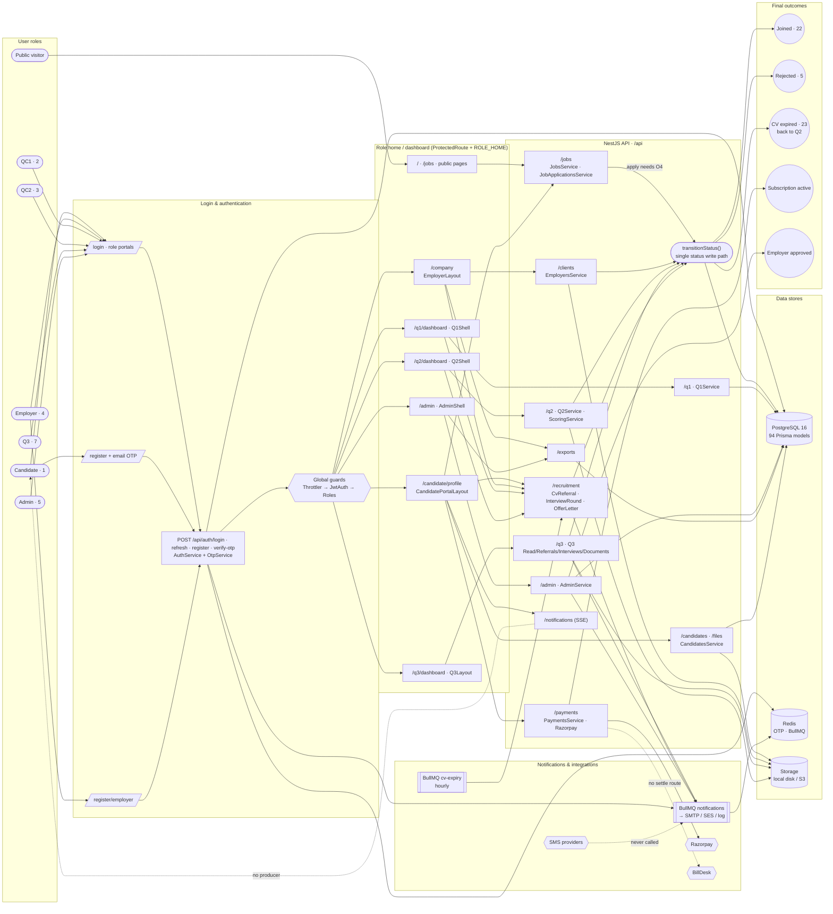
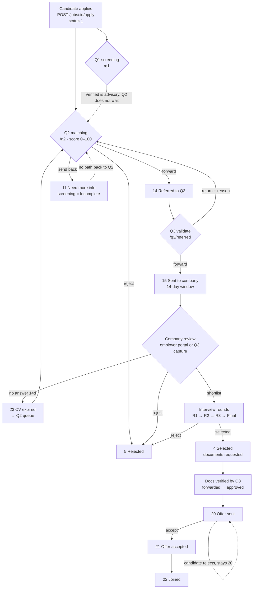
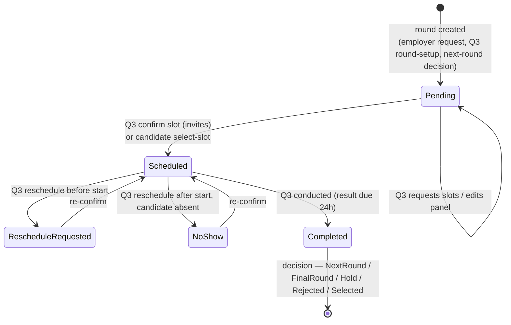
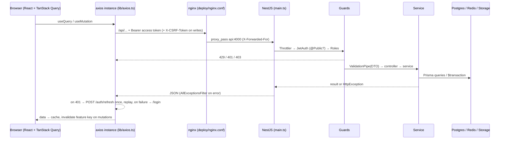
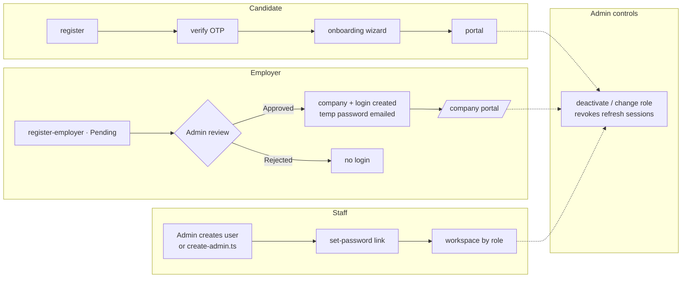

# Master System Flow

> One diagram that connects roles, login, dashboards, modules, APIs, services, data stores, notifications and outcomes, followed by focused diagrams for the complex parts. Everything shown exists in code at commit `8de48cf`. Dashed lines mark paths that exist but are broken or unused (see TESTING_AND_ISSUES).

## 1. Master flow

### How to read it

1. **Roles → login.** Candidates self-register with email OTP. Employers submit a registration that an admin must approve. Staff accounts are created by an admin.
2. **Guards.** Every API call passes the throttler, the JWT check and the role check (`apps/api/src/app.module.ts`). On the web, `ProtectedRoute` sends each role to its home (`apps/web/src/types/roles.ts`).
3. **Dashboards → modules.** Each workspace calls its own API module. Shared hiring actions live in `/recruitment`.
4. **Status writes.** All application status changes funnel through `JobApplicationsService.transitionStatus` (`apps/api/src/modules/jobs/job-application.service.ts:167`). It writes the mapping, a status log row and the latest-status table in one transaction.
5. **Async.** Emails go through the BullMQ `notifications` queue. The hourly `cv-expiry` job returns unreviewed CVs to Q2 after 14 days.
6. **Outcomes.** These are joined, rejected, expired (re-queued), subscription active and employer approved.

## 2. Hiring pipeline: hand-offs between desks

## 3. Interview round lifecycle (one round)

Two writers record outcomes. Q3 uses `decision`, `decidedAt`, `isFinal` and `ApplicationHiring`. The employer and `/recruitment` path (`submitResult`) uses `result` only. That split is the root cause of TESTING_AND_ISSUES W-01.

## 4. Request lifecycle (any API call)

## 5. Account lifecycle per role

Related documents: [COMPLETE_WORKFLOW.md](COMPLETE_WORKFLOW.md) (step-by-step), [ROLE_PERMISSION_MATRIX.md](ROLE_PERMISSION_MATRIX.md), [API_DOCUMENTATION.md](API_DOCUMENTATION.md), [DATABASE_SCHEMA.md](DATABASE_SCHEMA.md).
