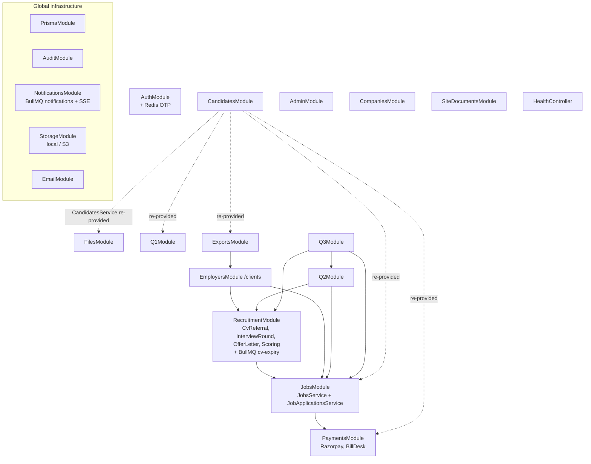

# Module Dependencies

> Module graph read from the `*.module.ts` files and service constructors in `apps/api/src`, and from feature imports in `apps/web/src`. Commit `8de48cf`.

## 1. Backend module graph

**Global modules** (`@Global()`; available to every module without importing): `PrismaModule` (`apps/api/src/prisma`), `AuditModule`, `NotificationsModule`, `StorageModule`, `EmailModule` (`apps/api/src/common/email`). `AppModule` also registers `BullModule.forRoot` (Redis), `JwtModule`, `ThrottlerModule` and the three global guards.

Dashed edges: `CandidatesService` is listed directly in the `providers` of FilesModule, JobsModule, PaymentsModule, Q1Module and ExportsModule instead of being imported from CandidatesModule. Each module therefore gets **its own instance** (stateless, so harmless today, but per-instance caches such as `JobsService.filtersCache` are duplicated). ExportsModule likewise re-provides `JobApplicationsService` and `RecruitmentService`.

## 2. Module catalogue

| Module | Purpose | Main files | Depends on | Used by | Roles | Status |
|---|---|---|---|---|---|---|
| **Auth** | Login, refresh rotation, OTP registration, employer registration, password reset, `/auth/me`, CSRF token | `modules/auth/auth.controller.ts`, `auth.service.ts`, `otp.service.ts`, `csrf.controller.ts`, `redis.provider.ts` | Prisma, Redis, Email (BullMQ), Audit | Every authenticated feature (tokens), Admin (reset tokens) | Public + Any | Implemented. Gaps: no SMS, CSRF unchecked, tokens not revocable |
| **Candidates** | Candidate profile and sections, documents, saved jobs, alerts, prefs, referrals, privacy, activity, recommendations | `modules/candidates/*` | Prisma, Storage, Audit | Files, Jobs (recommendations), Payments, Q1, Exports, Recruitment (`profile`, `resumeFile`) | Candidate | Implemented. Prefs partly saved; referrals/privacy/export not acted on |
| **Files** | Upload/download (resume, avatar, generic) | `modules/files/files.controller.ts`, `avatar-url.ts` | Storage, Candidates, Audit | Candidate portal | Candidate, Any, Public | Implemented. Generic download unscoped |
| **Storage** | File persistence abstraction | `modules/storage/storage.service.ts`, `drivers/local.driver.ts`, `drivers/s3.driver.ts` | env, Prisma (`tblMstrDocuments` folders) | Files, Candidates, Employers, Q2, Q3, Recruitment, Site documents | — | Implemented. No deletion |
| **Jobs** | Public job search, detail, apply; **`JobApplicationsService.transitionStatus`** (the single write path for application status) | `modules/jobs/jobs.service.ts`, `job-application.service.ts` | Payments (subscription gate), Candidates | Employers, Recruitment, Q2, Q3, Exports | Public, Candidate | Implemented |
| **Payments** | Plans, Razorpay orders/verify/webhook, BillDesk orders, subscriptions | `modules/payments/*` | Candidates, Prisma, Audit | Jobs (`hasActiveSubscription`) | Public, Candidate | Razorpay implemented; BillDesk settle unreachable |
| **Recruitment** | Legacy QC screens + shared hiring services: CV referral lifecycle, interview rounds, offers, scoring, mapping access, staff directory, CV-expiry processor | `modules/recruitment/*` | Jobs, Candidates, Storage, Email, Audit, BullMQ `cv-expiry` | Employers, Q2, Q3, Exports | QC1, QC2, Q3, Client, Candidate, Admin (per route) | Implemented; overlaps with Q3 logic |
| **Employers** (`/clients`) | Employer portal API | `modules/employers/*` (`clients/` = deprecated re-exports) | Jobs, Recruitment (InterviewRound, CvReferral), Storage, Audit | Exports | Client (Admin listed, gets 404) | Implemented. Team, invoice payment missing |
| **Q1** | Screening workspace + analytics | `modules/q1/*`, `shared/screening.ts` | Candidates, Prisma, Audit | Q2 (writes `SubscriberScreening` on send-back) | QC1, Admin | Implemented |
| **Q2** | Matching workspace + analytics | `modules/q2/*`, `shared/matching.ts` | Jobs, Recruitment (Scoring, CvReferral), Storage | Q3 (reuses `Q2Service.factsFor`) | QC2, Admin | Implemented |
| **Q3** | Hiring-ops workspace: referrals, company review, scheduling, interviews, decisions, documents, offers, returns, report | `modules/q3/*`, `shared/hiring.ts` | Jobs, Recruitment (CvReferral, OfferLetter), Q2 (`Q2Service` completeness loader, `q3.module.ts:22`), Storage, Email | — | Q3, Admin | Implemented |
| **Admin** | Users, staff accounts, employer approval, job moderation, applications (read-only), audit, settings, blog, stats | `modules/admin/*` | Prisma, Email, Audit, `recruitment/staff-directory.ts` | — | Admin | Implemented. Settings not enforced |
| **Exports** | CSV/XLSX/PDF reports | `modules/exports/*` | Employers, Candidates, Recruitment, JobApplications | Admin reports page | QC1, QC2, Client, Admin | Implemented; two filter bugs |
| **Notifications** | BullMQ `notifications` queue + worker, email/SMS providers, SSE in-app notifications | `modules/notifications/*` | Redis, provider SDKs | Email service (all mail), web SSE | Any | Email works; SMS never called; in-app never populated |
| **Audit** | `tblAuditLog`, login/logout rows | `modules/audit/audit.service.ts` | Prisma | Most modules | — | Implemented (gaps listed in TESTING_AND_ISSUES) |
| **Companies** | Public company search/page | `modules/companies/*` | Prisma | Public pages | Public | Implemented |
| **Site documents** | Public downloadable documents | `modules/site-documents/*` | Storage | Student guide page (`features/public/pages/StudentGuidePage.tsx`) | Public | Implemented (CLI publishing only) |
| **Health** | Liveness/readiness | `modules/health/health.controller.ts` | Prisma, Redis | Docker HEALTHCHECK, CI wait-on | Public | Implemented |

## 3. Shared services and utilities (backend)

| Utility | Location | Consumers |
|---|---|---|
| `JobApplicationsService.apply` / `transitionStatus` | `modules/jobs/job-application.service.ts` | Jobs, Recruitment, Employers, Q2, Q3 (every status change) |
| `CvReferralService` | `modules/recruitment/cv-referral.service.ts` | Q2 (forward), Q3 (forward/return/resend), Employers (`markShortlisted`), CV-expiry processor |
| `InterviewRoundService` | `modules/recruitment/interview-round.service.ts` | Recruitment routes, Employers |
| `OfferLetterService` | `modules/recruitment/offer-letter.service.ts` | Recruitment routes, Q3 documents |
| `ScoringService` | `modules/recruitment/scoring.service.ts` | Recruitment, Q2 |
| `MappingAccessService` | `modules/recruitment/mapping-access.service.ts` | Recruitment routes (ownership for Candidate/Client) |
| `staffDirectory` | `modules/recruitment/staff-directory.ts` | Admin, Q2/Q3 mails |
| `createStaffLogin` | `modules/admin/staff-account.ts` | Admin, `scripts/create-admin.ts` |
| `EmailService` | `common/email/email.service.ts` | Auth, Admin, Recruitment, Q3 |
| `AuditService` | `modules/audit/audit.service.ts` | Auth, Candidates, Files, Employers, Jobs, Payments, Recruitment, Q1, Q2, Q3, Admin, Exports |
| Vocabularies | `shared/roles.ts`, `status.ts`, `screening.ts`, `matching.ts`, `hiring.ts` | API modules; `roles.ts` is mirrored in `apps/web/src/types/roles.ts` |

## 4. Frontend modules and shared code

| Frontend area | Folder | API module(s) used | Shared code it relies on |
|---|---|---|---|
| Auth | `features/auth` | Auth | `lib/axios`, `lib/tokenStorage`, `auth.store` |
| Public & home | `features/public`, `features/home` | Companies, Payments (plans), Site docs | `components/layout/PublicLayout`, `Seo` |
| Jobs | `features/jobs` | Jobs, Candidates (saved jobs), Payments (gate) | `JobsLayout`, searchable selects |
| Candidate portal | `features/candidates/portal` (+ legacy `features/candidates/pages`) | Candidates, Files, Jobs, Recruitment (rounds, offers), Notifications | `CandidatePortalLayout`, `profileCompletion.ts`, `useSSE` |
| Payments | `features/payments` | Payments | Razorpay checkout script |
| Employer portal | `employer/` (+ public company page in `features/clients`) | Employers (`/clients`), Recruitment (offers/rounds), Exports | `EmployerLayout`, `employer/components/Tables/DataTable` |
| Q1 | `features/q1` | Q1, Recruitment (resume) | `Q1Shell` |
| Q2 | `features/q2` | Q2, Recruitment (resume) | `Q2Shell` |
| Q3 | `features/q3` | Q3 | `Q3Layout`/`Q3Shell`, toast provider |
| Legacy recruitment | `features/recruitment` | Recruitment | `DashboardLayout`, `components/ui/Table` |
| Admin | `features/admin` | Admin, Exports | `AdminShell`, `admin/components/primitives` |
| Cross-cutting | `components/ui`, `components/layout`, `hooks`, `lib` | — | Used by all areas |

## 5. How the modules communicate

- **Synchronous calls**: the only runtime channel between backend modules is direct NestJS dependency injection. There is no internal HTTP or event bus.
- **Database**: modules share state through common tables. Every status change goes through `tblJobSubscriberMapping.JobMapStatusID`, plus that module's own state tables (`tblSubscriberScreening`, `tblApplicationMatchReview`, `tblCvReferral`, `tblInterviewRound`, `tblApplicationHiring`, `tblOfferLetter`). These parallel state stores can drift; see TESTING_AND_ISSUES W-01…W-07.
- **Asynchronous**: BullMQ on Redis carries two queues, `notifications` (emails) and `cv-expiry` (hourly).
- **Frontend to backend**: REST over `/api` through one axios instance, with TanStack Query caching. Each feature invalidates its own key prefix (`['q1']`, `['q2']`, `['q3']`, `['admin']`, `['employer']`, `['candidate']`).
- **Server to browser push**: an SSE stream at `/api/notifications/stream` exists, but no producer publishes to it.

## 6. Implementation status summary

| Status | Modules / features |
|---|---|
| **Fully implemented** | Auth (email OTP), candidate profile, public job search/apply, employer portal core, Q1, Q2, Q3, admin panel, Razorpay payments, exports, storage, email delivery, CV expiry job, audit |
| **Partially implemented** | Notifications (email only; in-app and SMS unused), payments (BillDesk path dead; no receipts), candidate privacy/export/deletion/referrals (recorded only), notification preferences (4 of 12 saved), legacy `/recruitment/*` screens (Q3 menu broken), employer analytics (exports truncated) |
| **Not found / placeholder** | Application withdrawal, employer team users, messaging, employer notifications/settings pages, company reviews, salary insights, public candidate profile, global search, OAuth, CV parsing, invoice creation, platform-settings enforcement, role 6 "Subscription" |
