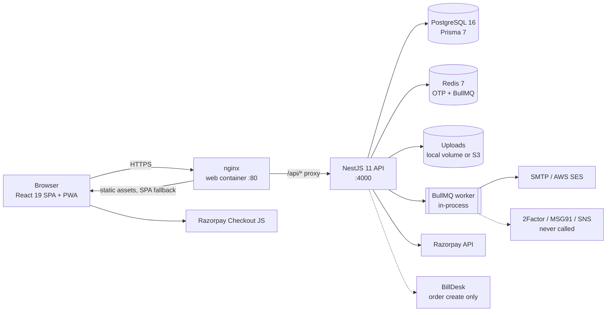

# Aajiveka — Project Overview

> Start here. This documentation set was produced by tracing the code at commit `8de48cf` (branch `main`, October 2026). It describes what the code does today, not what it is intended to do; where the two differ, the gap is recorded in [TESTING_AND_ISSUES.md](TESTING_AND_ISSUES.md).

## 1. What the application is

Aajiveka is a **recruitment / applicant-tracking platform** for the Indian job market. It rebuilds the legacy **AajivikaPortal** (ASP.NET Web Forms + SQL Server) as a TypeScript monorepo. Its schema was derived from a restored copy of the legacy database (73 tables, 97 stored procedures).

The business model:

- **Candidates** register, build a profile and CV, buy a time-limited subscription, and apply to jobs.
- **Employers** register, are approved by an admin, post jobs and run their own selection.
- An internal staff pipeline sits between the two:
  - **Q1** screens candidate profiles.
  - **Q2** scores each application against the job and refers the best CVs.
  - **Q3** forwards CVs to the company, coordinates interview rounds, collects documents and issues the offer through to joining.
- **Admins** approve employers, manage users and moderate jobs.

## 2. Documentation map

| Document | Answers |
|---|---|
| [PROJECT_OVERVIEW.md](PROJECT_OVERVIEW.md) | What it is, architecture, technology, environments (this file) |
| [PROJECT_STRUCTURE.md](PROJECT_STRUCTURE.md) | Which directory or file does what |
| [ROLE_PERMISSION_MATRIX.md](ROLE_PERMISSION_MATRIX.md) | Who can do what; implemented vs not-implemented roles |
| [COMPLETE_WORKFLOW.md](COMPLETE_WORKFLOW.md) | Every business workflow end to end, with sequence diagrams and the status state machine |
| [MODULE_DEPENDENCIES.md](MODULE_DEPENDENCIES.md) | Backend/frontend modules, how they depend on each other, implementation status |
| [DATABASE_SCHEMA.md](DATABASE_SCHEMA.md) | Models, relationships, ERD, status vocabularies, data lifecycle, migrations |
| [API_DOCUMENTATION.md](API_DOCUMENTATION.md) | Every endpoint: method, path, auth, roles, payloads, errors, integrations |
| [FRONTEND_BACKEND_MAPPING.md](FRONTEND_BACKEND_MAPPING.md) | Page → component → API → service mapping; dead UI |
| [TESTING_AND_ISSUES.md](TESTING_AND_ISSUES.md) | What was tested, coverage gaps, classified findings, runtime checks still needed |
| [MASTER_SYSTEM_FLOW.md](MASTER_SYSTEM_FLOW.md) | One master diagram plus focused diagrams for complex flows |

## 3. Architecture

- **Single API, single SPA.** The browser reaches the API only through nginx at `/api`, and the API container is never published (`docker-compose.yml`, `deploy/nginx.conf`). In development, Vite proxies `/api` to `localhost:4000`.
- **Authentication.** Short-lived JWT access tokens (15 min, held in memory) are paired with rotating refresh tokens (7 days, localStorage, allow-listed in `tblSecActiveSessions`). Separate secrets sign the two token types.
- **Authorization.** Global guards make every route authenticated by default (`@Public()` opts out) and restrict it by role id (`@Roles(...)`). Ownership checks live in services.
- **Background work.** There are two BullMQ queues on Redis: `notifications` (email/SMS delivery with retries) and `cv-expiry` (hourly job that expires CVs a company has not reviewed in 14 days).
- **Legacy compatibility.** Table and column names keep their SQL Server spelling (`tblXxx`, PascalCase) via Prisma `@@map`/`@map`, and role ids and status ids match the legacy seed data.

## 4. Technology stack

| Layer | Technology |
|---|---|
| Frontend | React 19, Vite 7, TypeScript (strict), Tailwind CSS v4, Radix UI (shadcn structure), TanStack Query, Zustand, React Hook Form + Zod, react-router (data router, lazy routes), react-i18next, vite-plugin-pwa, MSW (dev/CI mocks), Storybook |
| Backend | NestJS 11 (Express 5), Prisma 7 with `@prisma/adapter-pg`, PostgreSQL 16, Redis 7 + ioredis, BullMQ, Argon2id, class-validator, Zod (env), Swagger, helmet, @nestjs/throttler, exceljs, pdfkit, nodemailer, AWS SDK v3 (S3, SES, SNS) |
| Payments | Razorpay (active), BillDesk ve1_2 JWS (legacy, incomplete) |
| Infra | Docker Compose (postgres, redis, api, web/nginx), AWS RDS + S3 + SNS in the prod overlay, EC2 deploy over SSH |
| CI | GitHub Actions: typecheck, lint, unit tests, Playwright (mocked), real-DB e2e, Docker build, deploy |
| Tests | node:test + tsx (API), Vitest + Testing Library (web), Playwright (mocked browser tests and real-API suites) |

## 5. Users at a glance

| Role (id) | Lands on | Main job |
|---|---|---|
| Candidate (1) | `/candidate/profile` | Build profile, subscribe, apply, attend interviews, upload documents, accept offer |
| QC1 (2) | `/q1/dashboard` | Screen candidate profiles |
| QC2 (3) | `/q2/dashboard` | Score and match applications; refer to Q3 |
| Employer (4) | `/company` | Post jobs, review applicants and forwarded CVs, run interview rounds |
| Admin (5) | `/admin` | Approve employers, manage users, moderate jobs, reports, audit |
| Subscription (6) | `/pricing` | **Defined but not implemented** |
| Q3 (7) | `/q3/dashboard` | Forward CVs, coordinate interviews, collect documents, issue offers, mark joined |

Details: [ROLE_PERMISSION_MATRIX.md](ROLE_PERMISSION_MATRIX.md).

## 6. End-to-end business flow (summary)

1. **Candidate onboarding**: email-OTP registration → onboarding wizard → profile and CV.
2. **Employer onboarding**: registration → admin approval (creates the company, login and temporary password) → job posting (Active immediately).
3. **Subscription**: the candidate buys a plan via Razorpay. This unlocks applying.
4. **Apply**: creates an application (status 1 MAPPED).
5. **Q1** screens the profile (advisory). **Q2** scores the application and forwards it to Q3 (14), sends it back to Q1 (11) or rejects it (5).
6. **Q3** validates and forwards the CV to the company (15). The company has 14 days to respond, or the CV expires (23) and returns to Q2.
7. **Company shortlist**: interview rounds R1 → R2 → R3 → Final (16–19), scheduled and confirmed by Q3.
8. **Selected (4)** → documents requested, verified, forwarded and approved → **Offer sent (20)** → **Accepted (21)** → **Joined (22)**.

Full detail with diagrams: [COMPLETE_WORKFLOW.md](COMPLETE_WORKFLOW.md) and [MASTER_SYSTEM_FLOW.md](MASTER_SYSTEM_FLOW.md).

## 7. Environments and configuration

| Environment | How it runs |
|---|---|
| Local dev | `docker compose -f docker-compose.yml -f docker-compose.dev.yml up -d postgres redis`, then `npm run dev` (API :4000, web :5173 proxied, BillDesk stub :4999) |
| Single-host Docker | `cp .env.example .env` → `docker compose up -d --build` → app on :8080. Migrations apply on API start. Seed masters with `npx tsx prisma/seed.ts`. First admin via `scripts/create-admin.ts` |
| Production overlay | `docker compose -f docker-compose.yml -f docker-compose.prod.yml up -d --build`: RDS (`RDS_HOST`), S3 storage, SNS SMS, SMTP/SES email, web on :80 |
| CI deploy | Push to `main` → all CI jobs → SSH to EC2 → `git pull` → `docker compose up -d --build` |

**Environment variables** (names only; values are secrets and are not reproduced here). The authoritative schema is `apps/api/src/config/env.ts`.

| Group | Variables |
|---|---|
| Core | `NODE_ENV`, `PORT`, `CORS_ORIGIN`, `APP_URL`, `THROTTLE_LIMIT_PER_MIN` |
| Data | `DATABASE_URL`, `SHADOW_DATABASE_URL` (dev), `REDIS_URL`, `POSTGRES_USER`, `POSTGRES_DB`, `POSTGRES_PASSWORD`, `RDS_HOST` |
| Auth | `JWT_ACCESS_SECRET`, `JWT_REFRESH_SECRET`, `JWT_ACCESS_TTL`, `JWT_REFRESH_TTL` |
| Storage | `STORAGE_DRIVER`, `STORAGE_LOCAL_ROOT`, `S3_BUCKET`, `AWS_REGION` |
| Email | `EMAIL_DRIVER`, `SMTP_HOST`, `SMTP_PORT`, `SMTP_USER`, `SMTP_PASSWORD`, `SMTP_SECURE`, `SMTP_FROM`, `SMTP_FROM_NAME`, `SES_FROM_EMAIL` |
| SMS | `SMS_DRIVER`, `TWOFACTOR_API_KEY`, `MSG91_AUTH_KEY`, `MSG91_TEMPLATE_ID`, `SNS_SENDER_ID`, `SNS_DLT_ENTITY_ID`, `SNS_DLT_TEMPLATE_ID` |
| Payments | `RAZORPAY_KEY_ID`, `RAZORPAY_KEY_SECRET`, `RAZORPAY_WEBHOOK_SECRET`, `BILLDESK_BASE_URL`, `BILLDESK_CLIENT_ID`, `BILLDESK_MERCHANT_ID`, `BILLDESK_SECRET_KEY` |
| Web build | `VITE_API_BASE_URL`, `VITE_USE_MOCKS`, `VITE_OAUTH_ENABLED`, `VITE_ANALYTICS_ENDPOINT` |
| Scripts | `SEED_DEMO_USERS`, `MSSQL_SA_PASSWORD` |

Configuration gaps found:

- No compose file forwards the `RAZORPAY_*` variables.
- The base compose file does not forward `EMAIL_DRIVER`/`SMS_DRIVER`, so it only logs email.

See TESTING_AND_ISSUES P-01 and I-01.

## 8. Implementation status

| Area | Status |
|---|---|
| Auth (email OTP, JWT rotation, password reset) | Implemented |
| Candidate portal (profile, CV, applications, interviews, documents, offers) | Implemented; some sections have no editor UI |
| Job search and apply | Implemented (subscription-gated) |
| Employer portal (jobs, applicants, rounds, documents, analytics, billing view) | Implemented; team, messaging and settings are placeholders |
| Q1 / Q2 / Q3 staff workspaces | Implemented; hand-off and decision logic inconsistent across paths |
| Admin panel | Implemented (read-only over pipeline by design); settings not enforced |
| Payments | Razorpay implemented; BillDesk incomplete; no receipts |
| Email | Implemented (log driver by default) |
| SMS, in-app notifications | Infrastructure only, never triggered |
| Exports | Implemented; two filter bugs |
| Legacy `/recruitment/*` screens | Still routed alongside the new workspaces; Q3's legacy menu is broken |

## 9. Key risks (top 8)

Details and evidence are in [TESTING_AND_ISSUES.md](TESTING_AND_ISSUES.md).

1. Any signed-in user can download any stored file by key (S-01). An employer can expose arbitrary files through the public logo route (S-02).
2. Employer document access is scoped to the candidate rather than to the application (S-03).
3. Razorpay is not configured in any Docker deploy, and BillDesk orders can never settle (P-01, P-02).
4. Two interview-decision engines (employer/recruitment vs Q3) write different fields. After an employer hire, the Q3 documents/offer flow never starts (W-01).
5. Status transitions have no from-state guard, and an unaudited "set any status" endpoint exists (W-02).
6. Employer registration fails when HR email is blank (F-01). Staff cannot log in by email (A-01).
7. Q1/Q2 CV download returns 401 (F-03). Q3's legacy menu screens return 403 (F-02).
8. There are no automated tests for payments, the employer lifecycle or the Q2/Q3 transition services.
